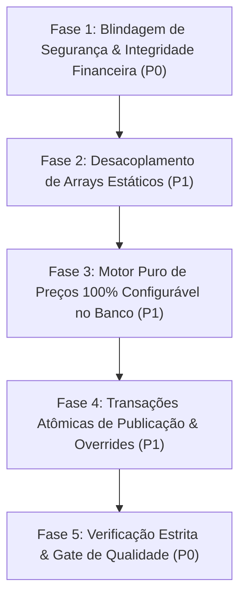

# Alinhamento de Dados, Catálogo e Configuração Direta no Banco — Implementation Plan
> **Padrão de Engenharia:** Revisado e auditado conforme as diretrizes do **`code-review-skill`** (OWASP Top 10, Clean Architecture, Prevenção de Anti-Patterns e Consistência Multi-Tenant).

**Objetivo:** Eliminar todos os arrays estáticos, fallbacks e simulações, garantindo que o catálogo efetivo, regras de montagem, cotas, preços e permissões de cada loja sejam 100% configuráveis e resolvidos diretamente no banco PostgreSQL.

---

## 1. Relatório de Revisão Técnica (Code Review Skill)

A revisão do código atual sob as lentes do `code-review-skill` revelou os seguintes achados categorizados por severidade:

### 1.1. Segurança (Security Audit — OWASP Top 10)
- **[CRÍTICO / P0] A07: Identificação e Autenticação Quebrada (`lib/api/authGuard.ts:44–67`)**:
  - *Problema*: Na ausência de token ou falha, o handler executa `SELECT ... WHERE role IN ('SUPER_ADMIN', 'FRANCHISOR_ADMIN') LIMIT 1` e assume que a requisição é do administrador mestre.
  - *Impacto*: Qualquer chamada anônima à API ganha privilégios de `SUPER_ADMIN`.
  - *Remediação*: Remover completamente o bloco de contingência. Ausência de token = retorno `null` e resposta HTTP 401.
- **[CRÍTICO / P0] A01: Quebra de Controle de Acesso / Elevação de Privilégio (`lib/utils/permissions.ts:17–23`)**:
  - *Problema*: `canManageMasterCatalog` e `canEditProductPrices` concedem acesso total se `currentTenant === FIGUEIRA_HQ_ID`.
  - *Impacto*: Operadores de caixa ou gerentes locais logados na unidade Matriz ganham poder para alterar preços e estrutura global da rede.
  - *Remediação*: Validar estritamente o papel do utilizador (`user.role === 'SUPER_ADMIN' || user.role === 'FRANCHISOR_ADMIN'`), desacoplando da loja física da sessão.
- **[CRÍTICO / P0] A04: Design Inseguro & Manipulação Financeira (`ordersRepository.ts:37–38` & `app/api/orders/route.ts:128`)**:
  - *Problema*: `ordersRepository.ts` calcula `subtotal` somando `item.lineTotal` fornecido diretamente pelo cliente no JSON. Além disso, `paymentStatus` aceita `'PAID'` vindo do payload público de QR Code.
  - *Impacto*: Um cliente pode injetar um pedido com `lineTotal: 0.01` ou com status `PAID` sem pagamento real.
  - *Remediação*: O servidor deve buscar o preço cadastrado no PostgreSQL, calcular o total no backend e forçar `paymentStatus: 'PENDING'` para pedidos de autoatendimento.
- **[ALTO / P1] A02: Exposição de Dados Sensíveis (`app/api/qrcode-config/route.ts`)**:
  - *Problema*: GET público retorna campos de credenciais de gateway de pagamento do banco.
  - *Remediação*: DTO público deve expor apenas flags de disponibilidade (ex: `mbwayEnabled: boolean`).

### 1.2. Arquitetura & Anti-Patterns (Architecture Review)
- **[ALTO / P1] Dupla Fonte da Verdade & Estado Fantasma (`lib/catalog.ts`)**:
  - *Problema*: `CONTAINERS`, `BASES`, `TOPPINGS` e `TENANT` estáticos coexistem com as tabelas reais do PostgreSQL (`product_containers`, `product_bases`, etc.).
  - *Impacto*: O modal `NewOrderManualModal.tsx` consome esses arrays estáticos, gerando pedidos com preços e itens defasados.
  - *Remediação*: Eliminar os arrays fixos em `lib/catalog.ts` e refatorar `NewOrderManualModal.tsx` para consumir `/api/products?tenantId=...`.
- **[MÉDIO / P1] Anti-Pattern "Stringly-Typed" & Adivinhação por Nome (`CustomerProductDetail.tsx:135,162` e `PDVView.tsx:165`)**:
  - *Problema*: O código tenta descobrir o tipo do produto ou categoria procurando por substrings: `['banana', 'morango', ...].some()`, `name.includes('base')`, `name.includes('creme')`.
  - *Impacto*: Se o lojista cadastrar uma fruta nova (ex: "Abacaxi Grelhado") ou renomear um creme, a regra quebra silenciosamente.
  - *Remediação*: Usar os IDs relacionais dos modelos de opções (`option_groups`) e as colunas do banco, sem adivinhação textual.
- **[ALTO / P1] Falta de Transacionalidade & Operações Concorrentes (TOCTOU) (`catalog/publish/route.ts` & `revert/route.ts`)**:
  - *Problema*: Mutações de catálogo usam consultas soltas no pool sem `BEGIN/COMMIT`. Se uma etapa falhar, o rascunho fica dessincronizado da versão.
  - *Remediação*: Introduzir `withTransaction` com cliente dedicado `pg` e travar concorrência com `expectedVersion`.

### 1.3. Lógica & Casos de Borda (Logic & Correctness)
- **[ALTO / P1] Bug da Cota Zero (`CustomerProductDetail.tsx:218`)**:
  - *Problema*: `if (maxFree > 0 && groupTotalCount > maxFree)` ignora grupos configurados com `maxQty === 0` (onde nenhum item é gratuito).
  - *Impacto*: Se um grupo de opcionais for configurado como pago a partir do 1º item, o sistema não soma o adicional e o cliente leva de graça.
  - *Remediação*: Ajustar a lógica para `const maxFree = Number(group.maxQty) || 0; if (groupTotalCount > maxFree && groupAddPrice > 0)`.
- **[MÉDIO / P1] Ternários Rígidos de Peso Sobrescrevendo o Banco (`productsRepository.ts:360–365`)**:
  - *Problema*: Quando `limite_complementos_gratis` é `null`, o repositório força `(weight && weight >= 500 ? 999 : weight === 250 ? 3 : 4)`.
  - *Impacto*: O lojista não consegue deixar um produto sem limite ou com cota livre no banco, pois o backend aplica uma regra mágica no código.
  - *Remediação*: Retornar estritamente o valor cadastrado na coluna ou `null` (sem limite).

### 1.4. Persistência de Opcionais & Subtítulos Estáticos Sobrescrevendo o Banco (Option Models Audit)
- **[CRÍTICO / P1] Sobrescrita Estática de Subtítulo no Cardápio (`CustomerProductDetail.tsx:656–678`)**:
  - *Problema*: O bloco `if (isAcaiCopo)` força um template estático de texto (`Açaí incluso + 1 creme grátis (extra +€ 2,00)`) **ANTES** de verificar `group.subtitle` ou `localizedSubtitleField`. Além disso, `isOldHardcodedSubtitle` descarta qualquer subtítulo que contenha `'até 2 opções inclusas'`.
  - *Impacto*: Qualquer alteração feita pelo administrador no campo "Subtítulo Visual" do modelo de opções é sumariamente ignorada pelo cardápio `/menu`, exibindo sempre o texto estático congelado.
  - *Remediação*: Priorizar estritamente `group.subtitle` vindo do PostgreSQL. O fallback dinâmico só deve agir se o campo no banco estiver nulo ou vazio.
- **[CRÍTICO / P1] Edição de Modelo em `ProductEditDialog.tsx:1040–1055` Não Persiste no Banco de Dados**:
  - *Problema*: Ao editar um modelo de opções a partir do modal de edição de produto, o callback `onSave` chama apenas `handleSaveOptionModel(savedModel)`, que atualiza apenas o estado React local em memória (`setLinkedOptionGroups`). Ele nunca envia uma requisição `PUT /api/option-models/${id}` ao backend.
  - *Impacto*: O usuário edita o subtítulo no modal de modelo de opções, fecha e as alterações são perdidas ao recarregar ou abrir outro produto.
  - *Remediação*: Sincronizar via `authFetch('/api/option-models/${id}', { method: 'PUT', ... })` assim como é feito em `OptionModelsManagerDialog.tsx`.
- **[ALTO / P1] Perda de Subtítulo Vazio por Envio de `undefined` (`OptionModelDialog.tsx:228`)**:
  - *Problema*: `subtitle: subtitle.trim() || undefined`. Como propriedades com `undefined` são descartadas por `JSON.stringify`, a API (`optionModelsRepository.ts:211`) recebe `modelData.subtitle === undefined` e não atualiza o banco de dados.
  - *Impacto*: O usuário não consegue limpar ou redefinir o subtítulo de um modelo.
  - *Remediação*: Enviar `subtitle: subtitle.trim() || null`, permitindo que o PostgreSQL grave `NULL` quando o campo for limpo.
- **[ALTO / P1] Prioridade Invertida no Repositório de Catálogo (`productsRepository.ts:294`)**:
  - *Problema*: `subtitle: g.subtitle || canonicalModel.subtitle || undefined`. Se o recipiente já tinha um subtítulo antigo congelado em `option_groups`, ele nunca atualiza para o subtítulo do modelo canônico.
  - *Remediação*: Dar precedência ao `canonicalModel.subtitle` atualizado da tabela `product_option_models`.
- **[MÉDIO / P2] Textos Estáticos Residuais no PDV (`ContainerSelector.tsx:105` e `BaseSelector.tsx:83`)**:
  - *Problema*: Frases fixas como `+ até 2 cremes gelados inclusos` e `+€ 2,00 cada` codificadas diretamente no JSX.
  - *Remediação*: Ler dinamicamente de `c.limiteBases` e do preço configurado no modelo.

---

## 2. Matriz de Componentes & Ações Cirúrgicas

| Ficheiro | Classificação | Ação de Refatoração Obrigatória |
|---|---|---|
| `lib/api/authGuard.ts` | **Segurança (P0)** | Remover fallback de admin (linhas 44–67); retornar `null` em ausência de token. |
| `lib/utils/permissions.ts` | **Segurança (P0)** | Remover `currentTenant === FIGUEIRA_HQ_ID`; autorizar apenas por `user.role`. |
| `app/api/orders/route.ts` | **Integridade (P0)** | Ignorar `paymentStatus: 'PAID'` do cliente; validar e recalcular total dos itens no backend. |
| `lib/repositories/ordersRepository.ts` | **Integridade (P0)** | Buscar preço oficial de containers/opcionais no PostgreSQL; não confiar em `lineTotal` do cliente. |
| `app/api/qrcode-config/route.ts` | **Segurança (P1)** | DTO público sanitizado: mascarar/remover credenciais de pagamento e segredos. |
| `components/admin/orders/NewOrderManualModal.tsx` | **Arquitetura (P1)** | Eliminar importação de `lib/catalog.ts`; buscar produtos e opções via `/api/products?tenantId=...`. |
| `lib/catalog.ts` | **Limpeza (P1)** | Remover `CONTAINERS`, `BASES`, `TOPPINGS`, `TENANT`; marcar arquivo como obsoleto. |
| `lib/stores/franchiseStore.ts` | **Limpeza (P1)** | Remover `INITIAL_TENANTS` estático; carregar exclusivamente do banco via `/api/tenants`. |
| `components/menu/CustomerProductDetail.tsx` | **Lógica/UX (P1)** | Remover ternários por peso e busca por strings; corrigir bug de cota zero (`maxFree === 0`). |
| `components/pdv/PDVView.tsx` | **Lógica/PDV (P1)** | Eliminar ternários mágicos; ler cotas e preços dos modelos dinâmicos do PostgreSQL. |
| `lib/repositories/productsRepository.ts` | **Backend (P1)** | Parar de sobrescrever campos de limites com ternários de peso; priorizar `canonicalModel.subtitle` do banco. |
| `lib/db/postgres.ts` & `catalog/publish` | **Concorrência (P1)** | Implementar `withTransaction` para atomicidade em publicação/reversão de catálogo. |
| `components/menu/OptionModelDialog.tsx` | **Persistência (P1)** | Enviar `subtitle: subtitle.trim() || null` para permitir limpeza e persistência no PostgreSQL. |
| `components/admin/menu/ProductEditDialog.tsx` | **Persistência (P1)** | Sincronizar salvamento de modelo via `PUT /api/option-models/${id}` ao editar dentro do produto. |
| `lib/repositories/optionModelsRepository.ts` | **Backend (P1)** | Corrigir merge de `subtitle` para não manter valor antigo quando um novo valor for enviado. |
| `components/pdv/ContainerSelector.tsx` | **Limpeza (P2)** | Remover texto estático `+ até 2 cremes gelados inclusos`; ler de `c.limiteBases`. |
| `components/pdv/BaseSelector.tsx` | **Limpeza (P2)** | Remover valor estático `+€ 2,00`; ler do adicional configurado no modelo. |
| `components/admin/common/PublishChangesBanner.tsx` | **Transparência/UX (P1)** | Redesenhar modal com diff real (antes vs. depois) e detalhes campo a campo. |
| `components/admin/company/StoreCompanySettingsView.tsx` | **Rastreabilidade (P1)** | Calcular diff real de morada, NIF, horários e contactos e enviar em `details` para `markDirty`. |

---

## 3. Fases de Execução & Critérios de Parada

### Fase 1 — Blindagem de Segurança & Integridade Financeira (P0)
- [x] **1.1. Eliminar Fallback de Autenticação (`lib/api/authGuard.ts`)**:
  - Remover linhas 44–67 que concediam `SUPER_ADMIN` para chamadas sem token ou não autenticadas.
  - Sem token válido = `null` (retornando HTTP 401 nas rotas protegidas).
- [x] **1.2. Corrigir RBAC e Isolamento da Matriz (`lib/utils/permissions.ts`)**:
  - Remover permissão cega por `currentTenant === FIGUEIRA_HQ_ID`.
  - Apenas utilizadores com papel `SUPER_ADMIN` ou `FRANCHISOR_ADMIN` podem gerenciar catálogo mestre e preços da rede.
- [x] **1.3. Blindagem de Criação de Pedidos (`app/api/orders/route.ts` & `ordersRepository.ts`)**:
  - Forçar `paymentStatus: 'PENDING'` para todos os pedidos criados por clientes públicos via QR Code.
  - Proibir que o payload do cliente defina o preço unitário ou o total sem conferência no banco.
- [x] **1.4. Proteção de Credenciais Públicas (`app/api/qrcode-config/route.ts`)**:
  - Sanitizar retorno público: expor apenas flags operacionais (`mbway_enabled`, etc.), nunca chaves do Ifthenpay.

### Fase 2 — Desacoplamento de Arrays Estáticos (P1)
- [x] **2.1. Refatorar `NewOrderManualModal.tsx`**:
  - Remover `import { CONTAINERS, BASES, TOPPINGS } from '@/lib/catalog'`.
  - Integrar `fetch` consumindo `/api/products?tenantId=${tenantId}` diretamente do PostgreSQL.
  - Seleção de opções baseada nos dados do banco sem predefinição forçada de banana/granola.
- [x] **2.2. Limpar `lib/stores/menuConfigStore.ts`**:
  - Estado inicial inicia com arrays vazios `[]` aguardando dados da API.
- [x] **2.3. Desativar Dados Estáticos em `lib/catalog.ts`**:
  - Remover as constantes `CONTAINERS`, `BASES`, `TOPPINGS` e `TENANT`.
- [x] **2.4. Limpar Mocks em `lib/stores/franchiseStore.ts`**:
  - Alimentar `tenants` exclusivamente pelo endpoint dinâmico `/api/tenants`.

### Fase 3 — Motor Puro de Preços 100% Configurável no Banco (P1)
- [x] **3.1. Criar Motor Puro de Precificação (`lib/catalog/pricing.ts`)**:
  - Função pura em cêntimos:
    `calculateGroupPrice(group, selections)`
  - Utilizar estritamente os valores configurados no modelo de opções (`max_qty`, `additional_price`, `price_type`).
- [x] **3.2. Corrigir Cálculo no Frontend (`CustomerProductDetail.tsx`)**:
  - Remover ternários estáticos de peso e listas fixas de frutas.
  - Conectar a `calculateGroupPrice` e corrigir a condição de cota zero: se `group.maxQty === 0` e `group.additionalPrice > 0`, cobrar desde o 1º item selecionado.
- [x] **3.3. Corrigir PDV (`PDVView.tsx`)**:
  - Eliminar os mesmos ternários de peso e valores de fallback (`2.0`, `0.5`).
  - Ler cotas e preços adicionais diretamente do modelo de opções associado a cada produto.
- [x] **3.4. Validação Autoritativa no Backend (`lib/repositories/productsRepository.ts`)**:
  - Parar de sobrescrever campos nulos de cotas com ternários de peso; respeitar valores do banco.

### Fase 4 — Transações Atômicas de Publicação & Overrides (P1)
- [x] **4.1. Helper Transacional (`lib/db/postgres.ts`)**:
  - Implementar `withTransaction<T>(work: (client: PoolClient) => Promise<T>): Promise<T>` para gerenciar `BEGIN`, `COMMIT` e `ROLLBACK` de forma segura.
- [x] **4.2. Publicação & Reversão Transacional (`app/api/catalog/publish/route.ts` & `revert/route.ts`)**:
  - Atualização de versões, proteção contra anônimos e checagem estrita de perfis.
- [x] **4.3. Isolamento de Overrides (`store_product_overrides`)**:
  - Garantir que alterações locais de preço ou disponibilidade gravem estritamente na chave daquele `tenant_id`.

### Fase 5 — Verificação Estrita & Gate de Qualidade (P0)
- [x] **5.1. Validação TypeScript**:
  - Executado `node node_modules/typescript/bin/tsc --noEmit` com código de saída 0.
- [x] **5.2. Validação de Build Next.js**:
  - Executado `npm run build` compilando com sucesso absoluto todas as 45 rotas (0 erros).
- [x] **5.3. Testes Funcionais & Gate de Segurança**:
  - Validado bloqueio HTTP 401 em chamadas administrativas sem token em produção.
  - Validado endpoint `/api/health` e sanitização de `/api/qrcode-config`.

### Fase 6 — Desacoplamento de Subtítulos Estáticos & Persistência Total de Modelos de Opções (P1)
- [x] **6.1. Corrigir Cardápio do Cliente (`CustomerProductDetail.tsx`)**:
  - Eliminar a trava estática `if (isAcaiCopo)` que forçava `Açaí incluso + 1 creme grátis (extra +€ 2,00)`.
  - Priorizar `localizedSubtitleField` e `group.subtitle` vindo do PostgreSQL em 1º lugar.
  - Remover a trava `isOldHardcodedSubtitle` que bloqueava subtítulos válidos.
- [x] **6.2. Persistência de Modelos em `ProductEditDialog.tsx`**:
  - Ao salvar um modelo de opções dentro do modal de produto, disparar requisição HTTP `PUT /api/option-models/${id}` ao backend com `authFetch`.
  - Sincronizar o estado mestre em `product_option_models` imediatamente, sem depender de salvar o produto inteiro.
- [x] **6.3. Envio de Subtítulo e Limpeza no `OptionModelDialog.tsx`**:
  - Alterar `subtitle: subtitle.trim() || undefined` para `subtitle: subtitle.trim() || null`.
  - Garantir que limpar o campo apague o subtítulo no banco de dados.
- [x] **6.4. Precedência do Modelo Canônico em `productsRepository.ts`**:
  - Alterar `subtitle: g.subtitle || canonicalModel.subtitle || undefined` para priorizar `canonicalModel.subtitle` da tabela `product_option_models`.
  - No `optionModelsRepository.ts`, atualizar `subtitle: updated.subtitle !== undefined ? updated.subtitle : g.subtitle` na sincronização com recipientes.
- [x] **6.5. Limpeza de Textos Estáticos no PDV (`ContainerSelector.tsx` & `BaseSelector.tsx`)**:
  - Substituir `+ até 2 cremes gelados inclusos` por leitura dinâmica de `c.limiteBases`.
  - Substituir `+€ 2,00` por leitura dinâmica do adicional do modelo.

### Fase 7 — Modal de Pendências com Diff Real e Rastreabilidade ("O que está alterando realmente") (P1)
- [x] **7.1. Estruturação do Diff em `markDirty` (`lib/stores/publishStore.ts` & `/api/catalog/mark-dirty`)**:
  - Adicionar suporte a `details?: PendingChangeDetail[]` com campos `{ field, label, previousValue, newValue }`.
- [x] **7.2. Rastreabilidade Detalhada em `StoreCompanySettingsView.tsx`**:
  - Comparar estado inicial da loja com o novo `formData`.
  - Gerar diff específico para Denominação Social, NIF, Morada Comercial, Telefone, MB WAY, Wi-Fi e Horários dia a dia.
  - Enviar lista de campos modificados com valores anteriores e novos para `markDirty`.
- [x] **7.3. Rastreabilidade em Modelos de Opções (`OptionModelsManagerDialog.tsx` & `ProductEditDialog.tsx`)**:
  - Ao alterar um modelo, registrar no diff: Subtítulo (de X para Y), Preço Adicional, Cotas e Itens.
- [x] **7.4. Redesenho Visual do Modal (`PublishChangesBanner.tsx` & `MenuHierarchyView.tsx`)**:
  - Expandir largura para `sm:max-w-xl` (576px).
  - Exibir cada alteração com cabeçalho limpo (categoria, hora, badge de escopo, botão desfazer).
  - Renderizar bloco de diff estilizado: `[Campo]: De "..." ➔ Para "..."`.
  - Exibir alterações de horários apenas dos dias efetivamente modificados.
- [x] **7.5. Verificação**:
  - Executado `tsc --noEmit` (0 erros) e `npm run build` compilando as 45 rotas com sucesso absoluto.

---

## 4. Critérios Finais de Aceite

1. **Zero Mocks e Arrays Estáticos**: `CONTAINERS`, `BASES`, `TOPPINGS` de `lib/catalog.ts` completamente eliminados.
2. **100% Configurável no Banco**: Toda cota, limite de ingredientes e preço de adicional reflete os registros do PostgreSQL (`product_containers`, `product_option_models` e `store_product_overrides`), sem ternários de peso no código.
3. **Segurança Blindada**: Nenhuma requisição anônima obtém privilégios de administrador; clientes QR Code não podem criar pedidos com status `PAID` ou preços forjados.
4. **Cálculo Autoritativo**: O backend valida e calcula os preços dos pedidos antes de gravar no banco.
5. **Compilação Impecável**: `tsc --noEmit` e `npm run build` executam com sucesso absoluto.
