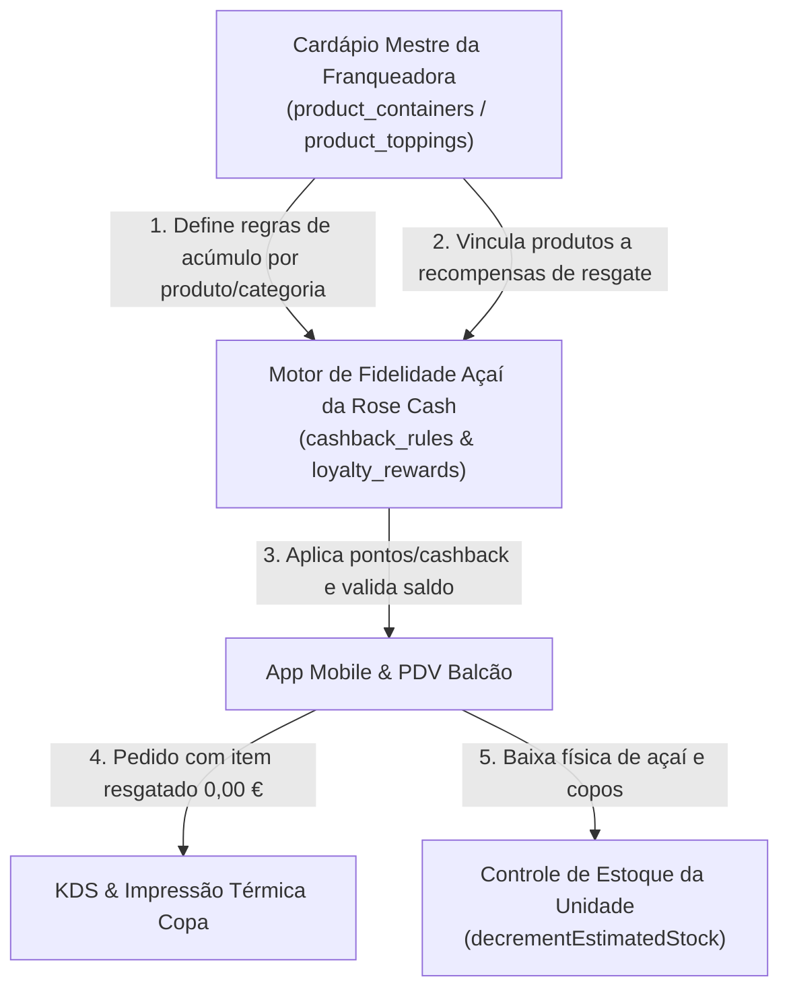
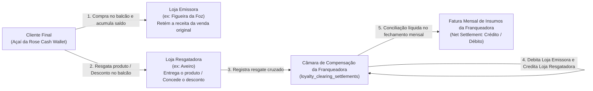
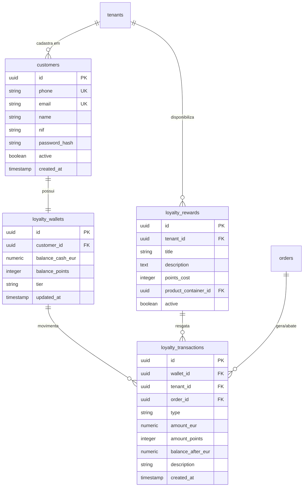
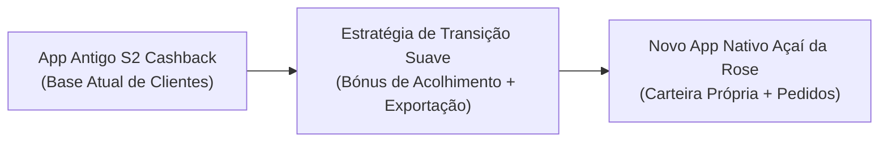
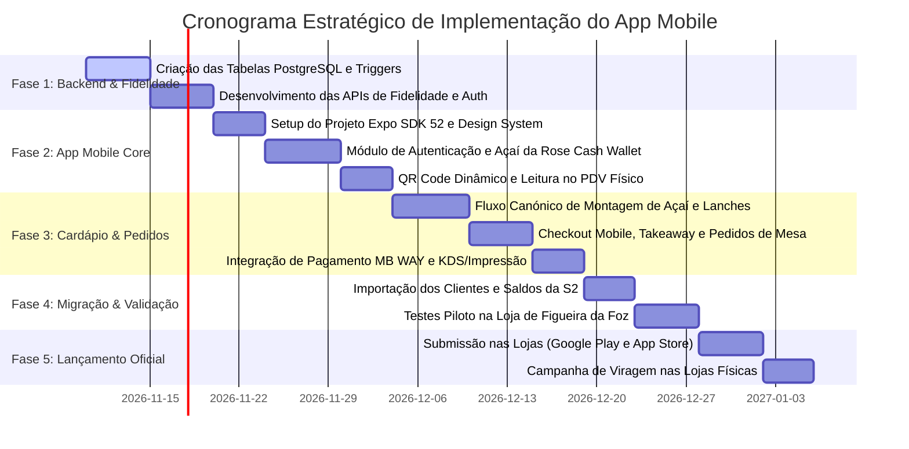

# PDR — Documento de Requisitos e Planeamento de Produto
## Novo Aplicativo Móvel Oficial Multi-Loja: Açaí da Rose Cashback
**Substituição da Plataforma Legada S2 Cashback e Integração Nativa ao Ecossistema Açaí da Rose**
> *Nome Oficial Mantido: O aplicativo preserva o nome consagrado **"Açaí da Rose Cashback"** nas lojas oficiais (Apple App Store e Google Play Store) para assegurar continuidade de marca, retenção da base de utilizadores e indexação ASO sem fricção.*

---

## 1. Sumário Executivo & Diagnóstico Estratégico

### 1.1. Contexto e Motivação
A rede **Açaí da Rose** opera atualmente lojas físicas em Portugal:
* **Loja 1 — Figueira da Foz (Matriz)**
* **Loja 2 — Torres Novas (Filial 1)**
* **Loja 3 — Aveiro (Franquia)**
* *Expansão contínua para novas unidades franqueadas da rede.*

Atualmente, o programa de fidelização e cashback para os clientes finais é provido por uma aplicação terceira desenvolvida sobre a plataforma **S2 Cashback** (acessível em `https://s2cashback.com/acai-da-rose/`, com pacotes na Google Play Store `com.s2cashback.acaidarose.s2cashback` e Apple App Store `id6744820271`).

Embora tenha servido como mecanismo inicial de acúmulo de pontos, o aplicativo da S2 Cashback tornou-se um **gargalo operacional e estratégico grave**:
1. **Silo de Dados & Duplicidade Operacional**: A plataforma S2 Cashback é completamente isolada do sistema central do Açaí da Rose (`app.acaidarose.pt`, PostgreSQL 16, Next.js 15). O operador de caixa precisa lançar o pedido no PDV próprio e, em seguida, registrar manualmente a transação ou escanear um código num terminal/aplicativo paralelo da S2 Cashback para creditar pontos, gerando filas, erros manuais e atrito no atendimento.
2. **Inexistência de Cardápio e Pedidos Integrados**: O app da S2 Cashback limita-se a um cartão de pontos virtual e resgate de prémios estáticos. O cliente **não consegue** fazer pedidos de takeaway (levantamento em loja), nem pedir na mesa via QR Code móvel, nem montar o seu açaí seguindo as regras canónicas do cardápio oficial.
3. **Incompatibilidade com o Multi-Tenant e Franquias**: O ecossistema S2 Cashback não suporta a estrutura multi-loja em tempo real da rede (isolamento de estoque, personalização de preços por loja, controle de acompanhamentos activos via `store_product_overrides`).
4. **Design Obsoleto e Genérico (White-Label Cafona)**: O visual do S2 Cashback reflete um modelo genérico pré-fabricado de terceiros, distante da identidade visual elegante, sóbria e premium estabelecida no Manual de Marca oficial do Açaí da Rose.
5. **Dependência Financeira e Perda de Controlo de Dados**: Pagamento contínuo de mensalidades a uma empresa externa e falta de posse direta sobre o histórico de consumo dos clientes, dificultando ações de retenção, marketing direto e cumprimento estrito do RGPD.
6. **Fricção de Cadastro e Exigência de NIF**: O aplicativo da S2 Cashback impõe ou prioriza o NIF (Número de Identificação Fiscal) no registo, gerando receio, rejeição no balcão e abandono de onboarding. No novo sistema, o **Telemóvel é o único identificador padrão obrigatório**, enquanto o NIF torna-se 100% facultativo (apenas para quem desejar fatura com contribuinte).

### 1.2. Objetivo Central deste Projeto
Substituir integralmente a solução da S2 Cashback pelo **aplicativo móvel nativo oficial Açaí da Rose Cashback** (iOS e Android), unificando num único produto digital:
* **Fidelidade & Cashback Nativo (Açaí da Rose Cash & Açaí da Rose Cash Wallet)** integrado diretamente ao banco de dados PostgreSQL e ao PDV físico.
* **Cardápio Digital Interativo** com a experiência gastronómica oficial da marca (montagem passo a passo com regras canónicas de recipientes, cremes e acompanhamentos).
* **Pedidos de Autoatendimento** (Takeaway para levantamento rápido no balcão e pedidos na mesa via leitura de QR Code).
* **Arquitetura Multi-Loja 100% Dinâmica**, adaptável imediatamente para as lojas atuais e para qualquer nova franquia que venha a ser cadastrada no sistema da Franqueadora.
* **Identidade Visual Sofisticada & Minimalista**, orientada por boas práticas internacionais (Apple Human Interface Guidelines + Google Material You), sem clichés visuais ou estética de inteligência artificial.

---

## 2. Análise Crítica do Sistema S2 Cashback Atual

### 2.1. Inventário de Canais e Aplicações Analisadas
* **Web Landing Page S2**: `https://s2cashback.com/acai-da-rose/`
* **Google Play Store**: Pacote `com.s2cashback.acaidarose.s2cashback`
* **Apple App Store**: ID `id6744820271` (Nome: *Açai da Rose*)

### 2.2. O que o App S2 Cashback oferece atualmente:
* Registo simplificado do utilizador (Nome, Telemóvel, E-mail).
* Exibição de saldo acumulado de cashback e pontos.
* Geração de QR Code estático do cliente para identificação no balcão.
* Lista básica de prémios resgatáveis (ex: copo de açaí, adicionais).
* Extrato de compras onde foram computados pontos da S2.
* Envio de notificações push genéricas.

### 2.3. Matriz de Gap: S2 Cashback vs. Novo Aplicativo Açaí da Rose

| Dimensão Funcional | App Atual (S2 Cashback) | Novo App Oficial Açaí da Rose |
| :--- | :--- | :--- |
| **Identificação & Cadastro** | Exige NIF como requisito do sistema, criando atrito e rejeição no onboarding. | **Telemóvel como padrão único**. Cadastro em 15 segundos (Nome + Telemóvel). NIF estritamente opcional. |
| **Integração com PDV Físico** | Nula. Requer operação manual paralela no caixa. | Nativa e instantânea via API própria; leitura de QR Code ou busca por telemóvel debita/credita em tempo real. |
| **Cardápio & Pedidos** | Inexistente. Apenas consulta de pontos. | Completo: montagem de açaí, seleção de cremes, lanches, takeaway e pedidos na mesa. |
| **Multi-Loja & Franquias** | Estático, sem contexto operacional de estoque ou unidade. | Dinâmico: detecta loja por GPS, seleciona loja ativa, respeita disponibilidade e preços locais. |
| **Produção & Cozinha (KDS/TV)** | Desconectado. | Conexão direta com a rotação de senhas na TV (`/chamada`) e impressoras térmicas da loja. |
| **Pagamentos em Portugal** | Não suporta pagamentos no app. | MB WAY nativo (via Ifthenpay), Apple Pay, Google Pay e cartão de crédito. |
| **Identidade Visual & UX** | Template genérico branco/roxo básico, ícones de stock. | Dark mode luxuoso (`#0A0612` e `#160F24`), tipografia Inter, transições fluidas e microinterações. |
| **Propriedade dos Dados & RGPD** | Dados hospedados em servidores de terceiros. | 100% sob controle da rede Açaí da Rose na VPS própria em PostgreSQL 16. |
| **Custos Operacionais** | Mensalidade fixa por loja + taxas à S2 Cashback. | Custo de infraestrutura zero adicional (já absorvido pelo backend existente). |

### 2.4. Auditoria Visual Forense das Telas Reais do App S2 Cashback (14 Telas Analisadas)
A análise detalhada das capturas de ecrã reais do aplicativo em produção (`fotos-app-cashback`) revelou anomalias graves de arquitetura, erros de conteúdo e oportunidades de melhoria que fundamentam a necessidade urgente de substituição:

1. **Erro Crítico de Template de Terceiros nos Termos de Uso (Risco Jurídico)**:
   * No ecrã de Termos de Uso em produção, a plataforma S2 Cashback cometeu um erro grosseiro de cópia e cola:
     > *"O presente aplicativo de cashback (**Big Pastel e Pizza**) é disponibilizado sob a licença da plataforma S2 Cashback... pessoa coletiva n.º 517968223, com sede em **[morada completa]**, doravante designada 'Licenciado'."*
   * O aplicativo oficial do Açaí da Rose está a exibir em plena loja de aplicações o nome de outro estabelecimento concorrente (*Big Pastel e Pizza*) e um marcador de texto esquecido (*[morada completa]*). Isso comprova a fragilidade, falta de suporte e amadorismo da solução terceirizada.

2. **A Prova do Conflito NIF vs. Telemóvel nos "Dados Pessoais"**:
   * Na tela de *Dados Pessoais*, o formulário prioriza: *Nome*, *E-mail*, *Telefone*, *Data de Nascimento* e *NIF*.
   * Na captura do utilizador real (Henrique), constata-se exatamente o problema apontado: o campo **NIF estava preenchido**, enquanto o campo **Telefone estava vazio**. A plataforma foi desenhada em torno do NIF como chave primária, criando forte atrito e resistência de cadastro no balcão físico. O novo app inverte isso: **Telemóvel obrigatório e NIF 100% facultativo**.

3. **Demora de até 24 Horas para Disponibilizar Pontos**:
   * Na secção de *Ajuda / FAQ*, o texto oficial da S2 assume: *"Os pontos... ficam disponíveis no seu saldo dentro de 24 horas"*. Essa latência gera desconfiança no cliente no balcão. O novo aplicativo nativo fará o crédito **em tempo real absoluto (milissegundos)** no momento em que o pedido for fechado no caixa ou pago pelo telemóvel.

4. **Identidade Visual Infantil & Clipart Desalinhado**:
   * O ecrã de Início exibe no topo um banner promocional de franquias com a ilustração 3D de um **super-herói roxo musculoso de capa e máscara** (*"Quer crescer junto? Que tal ter uma Loja do Açaí da Rose?"*). Esse estilo de clipart infantil e genérico quebra totalmente a sofisticação, o requinte artesanal e a postura de franquia premium da marca.
   * Fundo cinzento plano e barra de progresso desbotada (0 a 1000 pts) sem gamificação real.

5. **Catálogo de Resgate Real Mapeado (Preservação de Direitos)**:
   * O ecrã de *Resgate* do app atual lista exatamente 3 prémios em produção:
     * **Balde 5 litros (4,2 kg de açaí)** — `1800 pts`
     * **Copo de Açaí 250 gr (220 gr)** — `130 pts`
     * **Copo de Açaí 350 gr (350 gr)** — `180 pts`
   * Esses prémios serão importados e preservados no novo motor de fidelidade (`loyalty_rewards`), garantindo que nenhum cliente perca poder de troca.

6. **Funcionalidades de Valor a Serem Mantidas e Refinadas**:
   * **Indique e Ganhe (Member-Get-Member)**: O app antigo possui a campanha *"Indique e Ganhe 10 Pontos! Cada amigo que indicar vale 10 pontos após a 1ª compra"*. Essa funcionalidade será modernizada no novo app com geração de link direto e código compartilhável via WhatsApp.
   * **Avaliação 5 Estrelas no Google**: O app antigo trazia um banner da Dona Rose solicitando avaliação no Google (`@acaidarose_pt`). O novo app automatizará essa solicitação no pós-venda para clientes satisfeitos.
   * **Canal de Captação de Franquias**: Em vez do super-herói de desenho animado, o novo app contará com um card editorial sofisticado no perfil e na home direcionando potenciais franqueados para a API oficial `/api/franchise-requests`.

7. **Ecrã de Histórico Vazio (Falha de UX)**:
   * O ecrã *"HISTÓRICO DE MOVIMENTOS"* é atualmente uma página cinzenta e estéril sem qualquer mensagem de boas-vindas ou *empty state* explicativo. O novo app trará visualização rica com badges de status, data, loja física onde comprou e extrato detalhado.

---

## 3. Arquitetura Multi-Loja & Expansão de Franquias

A arquitetura do novo aplicativo móvel foi concebida para **escalar sem necessidade de novas compilações ou alterações no código do app** sempre que uma nova franquia for aberta.

```mermaid
flowchart TD
    App["App Mobile Açaí da Rose\n(iOS / Android)"]
    API["API Gateway Next.js 15\n(app.acaidarose.pt/api)"]
    DB[("PostgreSQL 16 Multi-Tenant")]

    App -->|1. Consulta lojas ativas /api/tenants| API
    App -->|2. Sincroniza cardápio contextual /api/products?loja=...| API
    App -->|3. Identificação no balcão /api/mobile/loyalty/identify| API
    App -->|4. Envia pedido mobile /api/orders (channel: MOBILE_APP)| API

    API --> DB

    subgraph Lojas ["Ecossistema Multi-Loja Dinâmico"]
        L1["Loja 1: Figueira da Foz (Matriz)"]
        L2["Loja 2: Torres Novas (Filial 1)"]
        L3["Loja 3: Aveiro (Franquia)"]
        LFuture["Futuras Franquias da Rede"]
    end

    DB -.->|Overrides de Preço e Estoque| Lojas
    API -->|Despacha impressão térmica na loja| Lojas
```

### 3.1. Resolução Dinâmica de Lojas
* **Proibição Estrita de Dicionários Estáticos**: O app mobile não terá nomes ou códigos de lojas fixados no frontend. Todas as unidades são carregadas em tempo de execução via `GET /api/tenants`.
* **Geolocalização Inteligente**: Ao abrir o aplicativo pela primeira vez, o app solicita permissão de localização (GPS) e calcula a distância geográfica (fórmula de Haversine) entre a posição do cliente e as coordenadas de cada loja cadastrada, selecionando automaticamente a unidade mais próxima.
* **Seletor de Loja no Topbar**: O cliente pode alternar a qualquer momento a loja ativa com 1 toque no cabeçalho do app (ex: trocar de *Figueira da Foz* para *Aveiro*).
* **Armazenamento de Preferência**: A última loja escolhida fica armazenada no dispositivo (`AsyncStorage`) para inicialização instantânea nas próximas sessões.

### 3.2. Sincronização de Cardápio e Disponibilidade Local
* Cada requisição de cardápio (`/api/products`, `/api/categories`, `/api/option-models`) envia o parâmetro `?loja=[tenantId]`.
* O backend aplica automaticamente a tabela `store_product_overrides`:
  * Se um produto ou acompanhamento específico estiver pausado na câmara fria de Aveiro, ele aparecerá desativado apenas para os clientes que estiverem com a loja de Aveiro selecionada.
  * Lojas com preços diferenciados (`store_price_overrides`) têm as suas cotações em Euro respeitadas sem impactar a Matriz.

### 3.3. Roteamento de Pedidos e Cozinha
Quando o cliente submete um pedido no aplicativo móvel:
1. O pedido é gravado na tabela `orders` com `channel = 'MOBILE_APP'` e `tenant_id` da loja selecionada.
2. O sistema de impressão local da loja (`serverPrintQueueService`) detecta a nova comanda e dispara a impressão térmica na impressora da copa/balcão daquela unidade física.
3. O número diário do pedido (`order_number`) é gerado na sequência diária daquela loja física (fuso horário de Portugal).
4. O cliente acompanha em tempo real o status: `AWAITING_PAYMENT` $\rightarrow$ `PREPARING` $\rightarrow$ `READY` $\rightarrow$ `COMPLETED`.

### 3.4. Governança de Franquias Não-Aderentes ao Cashback
O ecossistema multi-tenant prevê formalmente o cenário em que uma franquia específica não participa do programa de fidelidade (ex: quiosque sazonal em zona de praia com operação temporária, ponto comercial em aeroporto/estação ou contrato de franquia com margem financeira diferenciada):

1. **Controle de Adesão por Loja (`tenants.cashback_program_enabled`)**:
   * Cada unidade cadastrada na tabela `tenants` possui a flag booleana `cashback_program_enabled` (padrão `true`).
   * A Franqueadora ou o Super Admin pode desativar o programa para uma unidade específica com 1 clique no painel web (`/admin/stores`).

2. **Comportamento no PDV Físico da Franquia Não-Aderente**:
   * **Bloqueio de Acúmulo**: Vendas registradas no caixa dessa unidade **não calculam nem creditam** saldo de Açaí da Rose Cash nem Pontos Açaí da Rose.
   * **Bloqueio de Resgate e Abatimento**: O sistema impede a aplicação de descontos de fidelidade ou a troca de vouchers de pontos nesta loja, protegendo o fluxo de caixa do franqueado de absorver custos de um programa que não aderiu.
   * **Mensagem Amigável no Caixa**: O terminal exibe um alerta sóbrio ao operador:
     *"Esta unidade não participa do programa Açaí da Rose Cashback. Venda processada sem fidelidade."*

3. **Comportamento no Aplicativo Móvel do Cliente**:
   * **Transparência Imediata**: Quando o cliente seleciona a loja não-aderente no topo do app (ou aproxima-se dela via GPS):
     * A tela inicial e o cardápio exibem uma etiqueta elegante e discreta:
       *"Unidade [Nome da Loja] • Não aderente ao programa de Cashback e Resgates."*
     * Os produtos do cardápio deixam de exibir os badges dourados de pontos de resgate.
   * **Proteção Absoluta do Saldo do Cliente**:
     * O saldo da **Açaí da Rose Cash Wallet** do cliente continua totalmente seguro e visível, com a indicação explicativa:
       *"O seu saldo de [X,XX €] e [Y pts] permanece intacto e pode ser utilizado em todas as lojas aderentes da rede (ex: Figueira da Foz, Torres Novas, Aveiro)."*
     * O cliente nunca perde o saldo; apenas fica ciente de que naquela unidade física específica o programa não opera.
   * **Vouchers Bloqueados com Orientação**: Se o cliente tentar resgatar ou aplicar um voucher nessa loja, o app informa previamente com cortesia:
     *"Este voucher é válido exclusivamente em lojas aderentes. Selecione outra unidade para resgatar."*

---

## 4. Módulo Nativo de Fidelidade & Cashback (Açaí da Rose Cash & Açaí da Rose Cash Wallet)

### 4.0. Princípio Fundamental: Zero Dados Pré-Definidos (Tudo Inicia Zerado & CRUD Completo)
Em total conformidade com as diretrizes arquiteturais do projeto Açaí da Rose:
* **Zero Seeds & Zero Mocks**: Nenhuma regra, nível de fidelidade, percentual de cashback ou item de prémio vem pré-definido, embutido ou "semeado" no código/banco de dados.
* **Início 100% Zerado**: Todas as tabelas relacionais de fidelidade iniciam estritamente vazias.
* **CRUD Completo Padronizado**: Toda e qualquer configuração é realizada em tempo de execução pela Franqueadora através de uma página administrativa dedicada (`/admin/cashback`), seguindo exatamente a mesma arquitetura de componentes, formulários, modais de confirmação segura (`SafeConfirmDialog`) e toasts de feedback das demais páginas do sistema (`CategoriesAdmin`, `MenusAdmin`, `ProductsAdmin`, `TenantsAdmin`).
* **Configurabilidade Absoluta**: O administrador tem controle total para criar, visualizar, editar, ativar/pausar e excluir:
  1. As regras de acúmulo de cashback e pontos por produto ou categoria;
  2. Os prémios resgatáveis e suas pontuações;
  3. Os níveis e patamares do Clube VIP (nomes, metas e benefícios);
  4. As campanhas promocionais temporárias;
  5. Os parâmetros de conciliação financeira entre lojas.

---

### 4.1. Mecânica de Acúmulo e Resgate (Dinâmica e Parametrizável)
* **Açaí da Rose Cash (Cashback em Euro)**:
  * Percentagem de cashback definida pelo administrador via CRUD (por produto, categoria ou geral da rede), acumulada na carteira digital do cliente (**Açaí da Rose Cash Wallet**) sob a forma de saldo em Euro (€).
  * O saldo de Açaí da Rose Cash pode ser utilizado como desconto em futuras compras (com teto percentual de abatimento definido pelo administrador no painel).
* **Pontos Açaí da Rose (Pontos para Prémios)**:
  * Fator de conversão parametrizável no painel (ex: configurado pelo administrador como X pontos por cada Euro gasto).
  * Pontos acumulados são utilizados para resgatar itens físicos cadastrados livremente no CRUD de recompensas.

---

### 4.2. Relação Direta do Cashback com o Cardápio Mestre da Franqueadora
O programa de fidelidade não é um módulo isolado, mas sim uma camada viva conectada à hierarquia canónica do catálogo:
`Menus` $\rightarrow$ `Categorias` $\rightarrow$ `Produtos / Recipientes (product_containers)` $\rightarrow$ `Opcionais (product_bases / product_toppings)`.



#### A. Regras Granulares de Acúmulo por Produto e Categoria (Criadas via CRUD)
O administrador cria as regras do zero no painel, vinculando-as ao catálogo mestre conforme a estratégia da rede:
1. **Regras por Categoria ou Produto Específico**: O operador seleciona qualquer produto ou categoria existente e define a % de cashback desejada (ex: 5% para açaí, 3% para lanches, 1% para bebidas industriais, ou qualquer outro valor comercial).
2. **Multiplicadores Promocionais Temporários**: O operador pode programar multiplicadores de pontos (ex: 2x ou 3x pontos) vinculados a determinados recipientes ou dias da semana, ativando e desativando com um único clique.

#### B. Ciclo Completo de Produção e Baixa de Estoque no Resgate
Quando o cliente resgata qualquer prémio cadastrado no CRUD:
1. **Geração do Pedido no Sistema**: O item entra no pedido oficial com valor de venda `0,00 €` (desconto fidelidade de 100%), associado ao `product_container_id` oficial.
2. **Impressão Térmica na Cozinha**: O sistema de impressão local (`serverPrintQueueService`) despacha a comanda para a impressora da copa/balcão da loja com a marcação destacada:
   ```
   ================================================
   *** RESGATE CLUBE AÇAÍ DA ROSE — 100% PONTOS ***
   Item: [Nome do Produto Cadastrado no CRUD]
   Bases / Acompanhamentos Selecionados
   TOTAL A PAGAR: 0,00 € ([X] pts debitados)
   ================================================
   ```
3. **Baixa Real no Inventário da Loja**: O motor de inventário (`decrementEstimatedStock`) abate fisicamente do estoque os insumos correspondentes ao produto resgatado (açaí, recipientes descartáveis, acompanhamentos), mantendo a integridade total do estoque.

#### C. Campos Nativos de Fidelidade no Cadastro de Produtos (Cardápio Mestre)
Para dar total controle operacional à Franqueadora e às Lojas, o modal de criação e edição de produtos (`ProductEditDialog` em `/admin/menu`) e a Central de Cashback passam a contar nativamente com **dois novos campos em cada produto**:

1. **Cashback Ativo / Desativo (`cashback_enabled` — Booleano)**:
   * **Função**: Controla se a venda deste produto específico dá direito a gerar cashback na compra do cliente.
   * **Ativo (`true`)**: O produto entra no cálculo da percentagem de Açaí da Rose Cash e pontos ao ser faturado no caixa ou pedido no app.
   * **Desativo (`false`)**: O produto é excluído do cálculo de acúmulo de cashback.
     * *Casos de Uso*: Itens com margem de lucro mínima ou tabelada (ex: águas minerais, refrigerantes industriais em lata, cervejas, sacos de transporte regulamentares de 0,10 € ou combos sazonais já com desconto agressivo).

2. **Número de Pontos para Resgate (`points_cost` — Inteiro Opcional)**:
   * **Função**: Define exatamente a quantidade de Pontos Açaí da Rose que o cliente precisa ter acumulados para resgatar este produto gratuitamente.
   * **Configuração com Valor (ex: `130`, `180`, `1.800`)**:
     * O produto torna-se automaticamente elegível como **Prémio de Fidelidade**.
     * É publicado imediatamente na vitrine da aba *Clube / Loja de Resgate* do aplicativo móvel com o badge: `[ Resgatar por X pts ]`.
     * No PDV físico, quando o operador identifica um cliente com pontos suficientes, o sistema exibe o atalho para trocar os pontos por este item em 1 clique.
   * **Vazio / Nulo (`NULL` ou `0`)**:
     * O produto é considerado de venda comum, não aparecendo como opção de resgate por pontos.
* **Sincronização Bidirecional**: O operador pode ativar/desativar o cashback e ajustar o número de pontos de resgate tanto diretamente no formulário do produto em `/admin/menu`, quanto em lote através da tabela de regras em `/admin/cashback`.

---

### 4.3. Central de Gestão Exclusiva no Painel Web (`/admin/cashback` / `CashbackAdminHub`)
No painel administrativo da plataforma Next.js (`app.acaidarose.pt`), será adicionado o módulo **`cashback_hub`** na barra lateral de navegação (`AppSidebar`), provendo uma interface executiva com **CRUD completo em todas as abas**, sem dados estáticos:

```
┌──────────────────────────────────────────────────────────────────────────────────────────────────────────────┐
│  CENTRAL DE FIDELIDADE & CASHBACK — AÇAÍ DA ROSE CASHBACK                                                     │
├───────────────┬─────────────────┬──────────────────┬───────────────┬───────────────────┬──────────────┬──────┤
│ 1. Métricas   │ 2. Regras por   │ 3. Catálogo de   │ 4. Níveis VIP │ 5. Compensação    │ 6. Gestão de │7. DEV│
│    Gerais     │    Cardápio     │    Prémios       │    do Clube   │    Entre Lojas    │    Clientes  │Master│
└───────────────┴─────────────────┴──────────────────┴───────────────┴───────────────────┴──────────────┴──────┘
```

#### Aba 1: Painel Geral & Métricas de ROI (Analytics de Fidelidade)
* **Visão em Tempo Real**: Total acumulado de Açaí da Rose Cash (€) e pontos ativos gerados por transações reais.
* **Volume Resgatado**: Valor total devolvido em descontos e brindes nos períodos selecionados.
* **Métrica de Retenção (LTV)**: Comparativo de ticket médio e recompra de clientes com fidelidade ativa vs. clientes avulsos.
* **Passivo de Pontos a Expirar**: Alerta contábil de pontos prestes a expirar nos próximos 30/60 dias.

#### Aba 2: Regras de Acúmulo por Cardápio (CRUD Completo — Tabela `cashback_rules`)
* **Iniciação Zerada**: A tabela nasce vazia; o administrador clica em `[ + Nova Regra de Cashback ]` para criar as regras que desejar.
* **Funcionalidades do CRUD**:
  * **Criar**: Modal para selecionar Categoria (`category_id`) ou Produto específico (`product_container_id`), definir % de Cashback, Multiplicador de Pontos e Loja (Global ou específica).
  * **Listar**: Tabela com filtros por loja, busca por nome e ordenação.
  * **Editar**: Ajuste dinâmico de percentuais e multiplicadores a qualquer momento.
  * **Ativar/Pausar**: Botão toggle para desativar temporariamente uma regra sem excluí-la.
  * **Excluir**: Exclusão segura com diálogo de confirmação (`SafeConfirmDialog`).

#### Aba 3: Catálogo de Recompensas (CRUD Completo — Tabela `loyalty_rewards`)
* **Iniciação Zerada**: Não há prémios pré-cadastrados. A Franqueadora ou Gerente adiciona livremente os itens que deseja disponibilizar para troca de pontos.
* **Funcionalidades do CRUD**:
  * **Criar Prémio**: Modal para definir Título, Custo em Pontos, seleção do Produto real do catálogo (`product_containers`), foto oficial, limite de resgates por cliente e escopo (Global ou Loja específica).
  * **Listar**: Grid de cards ou tabela com status, fotos e estoque.
  * **Editar**: Alteração da pontuação exigida ou do produto associado.
  * **Ativar/Pausar**: Toggle para pausar imediatamente o prémio se o estoque estiver baixo.
  * **Excluir**: Remoção lógica do catálogo de resgate.

#### Aba 4: Gestão de Níveis VIP (CRUD Completo — Tabela `loyalty_tiers`)
* **Iniciação Zerada**: Os níveis do Clube Açaí da Rose não são fixados no código (nenhum nome como "Bronze/Prata" é rígido). O administrador cria quantos níveis desejar através do CRUD:
  * **Criar Nível**: Modal para definir Nome do Nível (ex: Bronze, Prata, Ouro, VIP, ou qualquer nomenclatura comercial desejada), Meta de Consumo Anual acumulado em Euro (€), Percentual de Cashback daquele nível e descrição dos benefícios.
  * **Listar**: Tabela ordenada por valor mínimo de consumo anual.
  * **Editar & Reordenar**: Ajuste de metas e benefícios.
  * **Excluir**: Exclusão de níveis obsoletos.

#### Aba 5: Compensação Financeira entre Lojas (Clearing Multi-Loja — `loyalty_clearing_settlements`)
* Relatório e conciliação financeira automatizada entre lojas da rede para resgates cruzados (*Cross-Store Redemptions*):
  * **Rastreabilidade Bidirecional**: Registra a loja emissora do saldo (`issuing_tenant_id`) e a loja onde o saldo foi resgatado (`redeeming_tenant_id`).
  * **Segregação por Tipo de Resgate**:
    * *Abatimento Financeiro (`CASH_DISCOUNT`)*: Reembolso euro por euro do desconto concedido na comanda.
    * *Reembolso de Prémio Físico (`PRODUCT_REWARD_REIMBURSEMENT`)*: Reembolso pelo custo padrão de insumos (CMV) do produto retirado do estoque local.
  * **Matriz de Liquidação Líquida (Net Settlement)**:
    * Em vez de cobranças avulsas entre franqueados, o sistema calcula o saldo líquido mensal de cada loja.
    * O crédito líquido é abatido automaticamente da fatura mensal de compras de insumos mestre da franquia junto da Franqueadora; o débito líquido é acrescido à fatura da loja devedora.
  * **Exportação & Fechamento**: Botão para exportar extrato detalhado em PDF/Excel e botão para homologar a compensação (`PENDING` $\rightarrow$ `SETTLED_IN_ROYALTIES`).

#### Aba 6: Gestão de Clientes & Validação de Pontos (`customers` & `loyalty_wallets`)
* **Busca Rápida por Telemóvel**: Campo de pesquisa rápida pelo número de telemóvel do cliente (`+351 9XXXXXXXX`) ou nome, trazendo imediatamente o perfil do cliente na tela.
* **Ficha de Fidelidade do Cliente**:
  * Saldo atual de Açaí da Rose Cash (€) e saldo de Pontos Açaí da Rose.
  * Nível VIP atual com barra de progresso para o próximo nível.
  * Histórico de pedidos e extrato cronológico completo de compras, acúmulos e resgates.
* **Validação & Ajuste Manual Supervisionado de Pontos**:
  * Permite ao operador ou gestor creditar ou debitar saldo manualmente (ex: cliente que comprou presencialmente mas o caixa estava em contingência offline sem internet, ou compensação de suporte pós-atendimento).
  * **Justificativa Obrigatória**: O formulário exige obrigatoriamente o preenchimento do motivo (ex: *"Compra offline conforme talão de venda nº 1042"*, *"Compensação suporte pós-venda"*).
  * **Aplicação Instantânea**: O saldo na carteira digital (**Açaí da Rose Cash Wallet**) do cliente é atualizado na hora, gerando registro formal na tabela `loyalty_transactions` e disparando notificação push no telemóvel do cliente.

#### Aba 7: Auditoria Forense para DEV Master (Super Admin Henrique)
* **Acesso Restrito & Seguro**: Área exclusiva para o perfil `SUPER_ADMIN` (Dev Master), integrada nativamente ao Dev Hub (`/dev`) e à tabela `audit_logs`.
* **Trilha de Auditoria Imutável (Audit Trail)**:
  * Registro detalhado de **100% das operações manuais ou sensíveis** de fidelidade:
    * **Operador Responsável**: ID, e-mail e nome do operador/gestor que realizou a ação.
    * **Cliente Alvo**: ID, nome e número de telemóvel afetado.
    * **Deltas de Saldo**: `balance_before` vs. `balance_after` (saldo anterior, valor adicionado/debitado e saldo final).
    * **Motivo & Contexto**: Justificativa digitada, IP de origem, User-Agent do dispositivo e timestamp exato com timezone de Portugal (`Europe/Lisbon`).
* **Monitor Anti-Fraude Automatizado**:
  * Painel de alertas visuais para detecção de anomalias operacionais:
    * Alerta se um operador conceder múltiplos créditos manuais no mesmo dia sem vinculação a pedidos fiscais.
    * Alerta de movimentações atípicas de acúmulo desproporcionais ao ticket médio da loja.
    * Botão de estorno administrativo emergencial com 1 clique para o Dev Master.

---

### 4.4. Fluxos Operacionais de Ponta a Ponta

#### Fluxo 1: Acúmulo no Balcão Físico (PDV)
1. O cliente escolhe os seus produtos no balcão da loja.
2. O operador pergunta com naturalidade: *"Tem o telemóvel registado no Açaí da Rose para acumular cashback?"*.
3. O cliente dita o telemóvel ou exibe o QR Code dinâmico do app.
4. O PDV exibe na tela o nome do cliente e aplica as regras ativas do cardápio mestre.
5. Venda finalizada com emissão fiscal $\rightarrow$ trigger no PostgreSQL credita Açaí da Rose Cash e Pontos Açaí da Rose na hora.
6. Push notification instantânea no telemóvel: *"Recebeu +0,42 € de Açaí da Rose Cash e +70 pontos na sua compra!"*.

#### Fluxo 2: Acúmulo no Pedido Mobile (Takeaway ou Mesa)
1. O cliente abre o app móvel com a loja ativa selecionada (ou escaneia o QR Code da mesa).
2. Monta o açaí respeitando as regras canónicas (2 cremes inclusos, adicionais a +2,00 €).
3. Na tela de confirmação de pagamento, o app exibe: *"Este pedido vai gerar +0,55 € de Açaí da Rose Cash"*.
4. Pagamento aprovado via MB WAY ou cartão $\rightarrow$ comanda é impressa na cozinha da unidade e os pontos caem na carteira em tempo real.

#### Fluxo 3: Resgate Financeiro (Abatimento na Conta)
1. No checkout do app móvel ou na tela do PDV físico, o sistema identifica que o cliente possui saldo de Açaí da Rose Cash (ex: `6,50 €`).
2. O sistema sugere abater o saldo, respeitando o teto de segurança configurado pela Franqueadora (ex: até 50% ou 100% do valor do pedido).
3. O valor abatido entra como linha de desconto fiscal no talão e o saldo residual na carteira do cliente é atualizado imediatamente.

#### Fluxo 4: Resgate de Produto Físico (Troca de Pontos por Item do Cardápio)
1. O cliente acessa a aba *Clube* no app móvel e clica em `[ Resgatar ]` num item do catálogo (ex: Copo 250g por 130 pts).
2. O app gera um voucher digital de resgate com código QR e validade de 30 dias.
3. O cliente pode adicionar o voucher diretamente num pedido mobile de takeaway ou apresentá-lo no balcão.
4. O PDV / App processa o item com custo `0,00 €`, debita os 130 pontos, despacha a impressão na copa e baixa os 250g de insumos do estoque da loja.

#### Fluxo 5: Expiração Automatizada com Aviso Prévio (12 Meses)
1. Todo lote de pontos possui validade de 12 meses a partir da data de compra.
2. Faltando 30 dias para a expiração, um job automatizado dispara uma notificação push amigável e mensagem no WhatsApp:
   *"Olá, Henrique! Os seus 180 pontos do Açaí da Rose expiram em 30 dias. Venha até à loja e troque por um Copo de 350g grátis!"*.
3. Essa comunicação reativa clientes dormentes e converte passivo em faturamento adicional (o cliente vai à loja buscar o brinde e consome acompanhamentos e outros itens pagos).

---

### 4.5. O Que Mais Dá Para Implementar? (Arsenal de Inovação & Alta Conversão)
Além do cashback tradicional e da troca de pontos, a plataforma própria viabiliza mecanismos modernos de gamificação e vendas recorrentes:

1. **Missões da Rose (Gamificação por Desafios Mensais)**:
   * Desafios interativos dentro da aba *Clube* do app móvel para engajamento lúdico:
     * *Missão 1*: *"Visite a loja 3 vezes este mês"* $\rightarrow$ Recompensa: +50 pontos extras.
     * *Missão 2*: *"Experimente um lanche artesanal acompanhado de açaí"* $\rightarrow$ Recompensa: +2,00 € de Açaí da Rose Cash bónus.
     * *Missão 3*: *"Indique 2 amigos que realizem a primeira compra"* $\rightarrow$ Recompensa: Badge VIP + 1 Copo 250g grátis.

2. **Cashback Turbo / Happy Hour (Otimização de Horários Ociosos)**:
   * A Franqueadora pode programar regras de cashback dobrado (ex: 8% a 10%) para dias e faixas horárias de menor movimento nas lojas físicas (ex: terças e quartas-feiras das 14h às 17h), induzindo fluxo em horários tradicionalmente frios.

3. **Cashback de Reativação Automático (Prevenção Ativa de Churn)**:
   * Clientes que não compram há mais de 35 dias recebem um depósito automático de urgência na carteira:
     *"Depositamos 2,50 € de presente na sua Açaí da Rose Cash Wallet! Válido apenas pelos próximos 4 dias."*
   * O prazo curto gera senso de urgência e reativa o hábito de consumo do cliente com custo marginal quase nulo.

4. **Presentear Amigos (Açaí da Rose Gift / Transferência de Saldo ou Copo)**:
   * O cliente pode enviar uma quantia de Açaí da Rose Cash (ex: 3,00 €) ou um voucher de Copo de Açaí diretamente para o telemóvel de um amigo como presente de aniversário ou agradecimento.
   * Ao receber a notificação por SMS/WhatsApp, o amigo é direcionado para baixar o aplicativo, gerando um canal viral de aquisição de novos clientes orgânicos para as lojas.

5. **Clube de Assinatura Recorrente ("Açaí da Rose VIP Pass / Assinatura Mensal")**:
   * Modelo de assinatura mensal (ex: 9,90 €/mês cobrado no cartão bancário ou MB WAY):
     * Garante 1 Copo 250g grátis por mês;
     * Cashback fixo ampliado para 8% em todas as compras;
     * Isenção permanente da taxa de sacos de transporte (+0,10 €);
     * Acesso em primeira mão a novos lançamentos e receitas sazonais da Franqueadora.

6. **Raspadinha Digital Pós-Pedido (Instant Win Gamificado)**:
   * Após a conclusão de qualquer pedido pago pelo app ou identificado no balcão, surge uma raspadinha digital no ecrã do telemóvel para raspar com o dedo.
   * O cliente concorre a prémios instantâneos aleatórios: de 0,20 € a 2,00 € de Açaí da Rose Cash para a próxima compra, um topping gourmet grátis ou um copo de açaí.

7. **Cashback de Aniversário Automatizado**:
   * Identificado pela data de nascimento opcional no perfil, o cliente é presenteado automaticamente com um saldo de 5,00 € ou um voucher de Copo 250g válido durante a semana do seu aniversário.

8. **Cashback B2B para Franquias (Abastecimento de Insumos da Franqueadora)**:
   * A Franqueadora pode premiar franqueados que realizam pedidos pontuais de insumos mestre (`supply_orders`) com créditos comerciais de cashback B2B, debitáveis nas compras de lotes de baldes de açaí puro, fortalecendo a conformidade e a relação franqueadora-franqueado.

9. **Retail Media Network (Parcerias Comerciais & Monetização — Roadmap Futuro)**:
   * Inspirado na secção de *"Parceiros/Publicidade"* observada na análise fotográfica do app legado.
   * No futuro, o aplicativo **Açaí da Rose Cashback** poderá operar como uma plataforma de Retail Media, abrindo uma nova linha de receita publicitária e parcerias estratégicas para a Franqueadora:
     * **Banners Patrocinados Nativos**: Espaços editoriais elegantes e não-intrusivos na Home do app para marcas parceiras complementares de prestígio (ex: fabricantes de granola artesanal, cremes gourmet de avelã/pistache, nutrição desportiva ou ginásios e estúdios de fitness locais próximos de cada loja da rede).
     * **Recompensas Co-Branded**: Marcas parceiras podem disponibilizar vouchers de desconto ou amostras grátis resgatáveis através de Pontos Açaí da Rose no app.
     * **Painel de Gestão Publicitária**: Controle de impressões, cliques (CTR) e segmentação geográfica por loja.
     * **Monetização para a Franqueadora**: Modelo comercial de patrocínio mensal ou CPM (Custo por Mil Impressões), monetizando a base ativa de utilizadores sem poluir visualmente a interface.
     * *Classificação*: Demarcado formalmente como **[Roadmap Futuro / Expansão Pós-Lançamento]**.

---

### 4.6. Identificação Flexível no Balcão Físico (QR Code ou Telemóvel)
O cliente conta com duas formas de identificação no momento do pagamento no balcão da loja física:
1. **Leitura de QR Code Dinâmico**: O aplicativo gera um QR Code com token temporário de alta segurança. O leitor óptico do PDV lê o ecrã instantaneamente.
2. **Ditado do Número de Telemóvel**: Caso o cliente esteja sem bateria ou prefira não tirar o telemóvel do bolso, basta ditar oralmente o seu número ao operador de caixa. O PDV busca a carteira em tempo real sem solicitar NIF ou documentos extras.

O fluxo no PDV ocorre de forma fluida:
1. O PDV identifica o cliente, exibe o seu nome e saúda o cliente no ecrã.
2. Exibe o saldo disponível de Açaí da Rose Cash.
3. O operador pergunta com cortesia: *"Deseja abater os seus 2,50 € de saldo nesta compra?"*.
4. Com um único clique no caixa, o desconto é aplicado e a venda é fechada.
5. O novo cashback gerado pela compra é creditado imediatamente na conta do cliente, disparando uma notificação push no telemóvel: *"Ganhou 0,45 € de Açaí da Rose Cash na sua compra!"*.

### 4.7. Níveis de Fidelidade 100% Configuráveis (Sem Patamares Rígidos)
Ao contrário de soluções que travam nomes e patamares no código, o novo sistema permite à Franqueadora criar, nomear e ajustar quantos níveis VIP desejar através do CRUD de Níveis (`loyalty_tiers`):
* O sistema **inicia sem nenhum nível pré-definido**.
* O administrador pode cadastrar os níveis que fizerem sentido para o momento da rede (ex: Nível Inicial, Nível Prata, Nível Ouro, VIP, ou qualquer outra nomenclatura).
* Para cada nível criado, o operador define via formulário:
  * Nome comercial do nível;
  * Valor de meta de consumo anual acumulado em Euro (€);
  * Percentual de cashback concedido a clientes daquele nível;
  * Benefícios exclusivos em texto livre (ex: brinde no aniversário, isenção de sacos de transporte, etc.).

### 4.8. Paradigma Zero-Fricção: Telemóvel como Padrão Universal vs. NIF Opcional
Ao contrário da abordagem da plataforma S2 Cashback (que priorizava ou exigia o NIF gerando atrito e desistência no registo), o novo aplicativo estabelece o **Telemóvel como o único identificador padrão obrigatório**:
* **Onboarding em 15 Segundos**: O cliente cadastra-se informando apenas **Nome** e **Telemóvel** (formato Portugal `+351 9XXXXXXXX` ou internacional).
* **NIF 100% Facultativo**: O NIF nunca bloqueia o registo nem o acúmulo de pontos. Fica disponível nas configurações de perfil como um campo opcional (*"Deseja NIF na fatura? (Opcional)"*). Se não for preenchido, o sistema emite automaticamente o documento fiscal como *Consumidor Final* conforme as exigências da Autoridade Tributária (AT).
* **Adequação a Turistas e Residentes**: Qualquer cliente nacional ou estrangeiro acumula e resgata cashback sem barreiras fiscais.

### 4.9. Programa "Indique e Ganhe" (Member-Get-Member Modernizado)
A análise das fotos reais confirmou que a campanha *"Indique e Ganhe +10 pontos no app após a 1ª compra do amigo"* já possui tração na rede. No novo app, esse motor será transformado em uma ferramenta nativa de crescimento viral:
* **Link Direto e Código de Partilha**: Cada cliente tem o seu código único (ex: `ROSE-HENRIQUE`) e um botão `[ Partilhar no WhatsApp ]` que gera uma mensagem personalizada e link direto com deep linking.
* **Automação de Recompensa Parametrizável**: O valor dos pontos de indicação e do bónus de boas-vindas é definido no painel administrativo via CRUD, podendo ser alterado a qualquer momento.

### 4.10. Cadastro de Prémios via CRUD (Sem Dados Iniciais ou Pré-Semeados)
Os 3 itens mapeados nas fotos do aplicativo antigo da S2 Cashback (*Balde 5 Litros, Copo 250g, Copo 350g*) servem estritamente como **referência histórica de mercado**:
* O banco de dados **inicia totalmente zerado**, sem nenhum prémio fictício ou pré-semeado.
* Através da aba *Catálogo de Recompensas* no painel web, a Franqueadora tem total autonomia para cadastrar esses ou quaisquer novos prémios do cardápio oficial que desejar oferecer, definindo o custo em pontos, imagem oficial e loja autorizada.

### 4.11. Expansão da Rede: Canal "Seja um Franqueado" (Substituindo o Mascote Infantil)
Nas fotos do app antigo, a captação de franqueados era ilustrada por um mascote 3D infantil de super-herói roxo (*"Quer crescer junto? Que tal ter uma Loja do Açaí da Rose?"*).
* **Novo Posicionamento Visual**: Substituição total do desenho animado por um card editorial elegante com fotografia real das lojas e tipografia refinada da marca.
* **Integração Nativa com a Franqueadora**: O clique no card abre o fluxo de candidatura com preenchimento em 3 etapas, gravando diretamente na tabela `franchise_requests` do PostgreSQL e alertando os diretores da rede no painel web `/admin/franchise-requests`.

### 4.12. Integração Nativa de Passes Digitais (Apple Wallet & Google Wallet)
Para reduzir a fricção no atendimento presencial e eliminar a necessidade de o cliente desbloquear o telemóvel e procurar o aplicativo móvel nas filas dos caixas das lojas físicas:

1. **Geração Dinâmica de Passes Digitais**:
   * **Apple Wallet (iOS)**: O backend gera um ficheiro binário oficial `.pkpass` assinado digitalmente com o certificado Apple Pass Type ID (`pass.pt.acaidarose.cashback`) da conta de desenvolvedor da marca. O passe adota a paleta noturna sofisticada da marca (`#0A0612` e `#160F24`), exibindo o logotipo oficial, o nome do cliente, o saldo atual em Euro de **Açaí da Rose Cash**, a pontuação acumulada em **Pontos Açaí da Rose**, a insígnia do nível VIP e o código de barras/QR Code de alta densidade (formato Aztec ou QR Code).
   * **Google Wallet (Android)**: Integração direta via Google Wallet REST API gerando um objeto de fidelidade (`LoyaltyObject`) assinado em JWT com a chave de serviço do Google Cloud Console.

2. **Atualização do Saldo em Tempo Real via Push Silencioso no Passe**:
   * Sempre que o cliente conclui uma compra no balcão físico de qualquer unidade (Figueira da Foz, Torres Novas, Aveiro ou futuras franquias) ou efetua um resgate de prémio, o backend dispara uma notificação APNs silenciosa para o PassKit da Apple e uma chamada de patch na API do Google Wallet.
   * O passe na Apple Wallet e na Google Wallet atualiza instantaneamente o saldo de cashback e os pontos no ecrã do smartphone do cliente, sem necessidade de abrir o app móvel.

3. **Geofencing de Proximidade das Lojas Físicas (Alerta na Tela de Bloqueio)**:
   * O ficheiro do passe armazena dinamicamente as coordenadas geográficas GPS (`latitude` e `longitude`) de todas as lojas ativas da rede obtidas via `GET /api/tenants`.
   * Ao aproximar-se de uma loja física da marca (raio configurável de ~100 metros), o sistema operacional do smartphone (iOS ou Android) projeta automaticamente o passe como um cartão interativo na tela de bloqueio do utilizador:
     *"Está próximo do Açaí da Rose! Toque para exibir o seu cartão de fidelidade no balcão."*
   * O cliente toca na notificação e o passe surge em tela cheia com brilho otimizado. O operador de caixa bipa o código óptico e a compra é pontuada em menos de 3 segundos.

4. **Botões Oficiais de Integração no App**:
   * Disponibilizados de forma elegante no **Card da Carteira** na tela inicial e no ecrã de **Perfil**:
     * Botão oficial Apple: `[ Add to Apple Wallet ]` (badge vetorial oficial conforme as diretrizes da Apple).
     * Botão oficial Google: `[ Adicionar à Carteira Google ]` (badge vetorial oficial conforme as diretrizes do Google).
   * Com 1 único toque, o passe é gerado e adicionado à carteira nativa do sistema operacional.

### 4.13. Sistema Inteligente de Notificações Push & Central de Mensagens
O aplicativo conta com uma infraestrutura robusta de mensageria móvel orquestrada via `expo-notifications`, comunicando-se com o Apple Push Notification service (APNs) no iOS e com o Firebase Cloud Messaging (FCM) no Android, sincronizada à coluna `push_token` da tabela `customers`.

1. **Notificações Transacionais em Tempo Real (Alta Prioridade)**:
   * **Crédito de Cashback no Caixa**: Disparada imediatamente após a emissão fiscal da venda no PDV físico:
     *"Recebeu +0,42 € de Açaí da Rose Cash e +70 pontos na sua compra na loja de [Nome da Loja]!"*
   * **Resgate de Prémio Concluído**: Disparada no momento do resgate no balcão:
     *"Resgate aprovado! 130 pontos debitados por Copo 250g no Açaí da Rose."*
   * **Status da Comanda de Takeaway**: Disparada em sincronia com o KDS da cozinha:
     * Preparação iniciada: *"O seu pedido #[order_number] começou a ser preparado com carinho na cozinha."*
     * Pedido pronto: *"O seu pedido #[order_number] está pronto para levantamento no balcão da loja!"*

2. **Notificações Automatizadas de Ciclo de Vida & Retenção (Engajamento Programado)**:
   * **Aviso Prévio de Expiração de Pontos (30 dias e 7 dias)**:
     *"Henrique, os seus 180 pontos do Açaí da Rose expiram em breve! Venha até à loja e troque por um Copo de 350g grátis."*
   * **Reativação Ativa de Clientes Inativos (> 30 dias sem compras)**:
     *"Depositamos 2,50 € de presente na sua Açaí da Rose Cash Wallet! Válido apenas pelos próximos 4 dias."*
   * **Felicitações de Aniversário**:
     *"Parabéns, Henrique! O Açaí da Rose depositou 5,00 € de presente na sua carteira para comemorar o seu dia."*
   * **Promoção de Nível VIP**:
     *"Parabéns! Acaba de subir para o nível Ouro no Clube Açaí da Rose com benefícios exclusivos."*

3. **Notificações de Proximidade (Geofence Alerts com Limite Estrito)**:
   * Disparadas quando o telemóvel do cliente entra no raio geográfico de uma loja física da rede.
   * **Regra Anti-Spam (Frequency Capping)**: O sistema impõe um limite máximo de **1 notificação de proximidade a cada 7 dias por utilizador**, garantindo que a comunicação seja oportuna e nunca invasiva.

4. **Central de Notificações no App (Notification Inbox)**:
   * Acessível diretamente pelo ícone de sino discreto no topo da tela inicial.
   * Mantém o histórico completo das mensagens transacionais e avisos recebidos nos últimos 60 dias, permitindo ao utilizador consultar comprovativos de saldo e códigos mesmo após dispensar o alerta da tela de bloqueio do smartphone.
   * Suporte a marcação visual de "não lidas" e ação rápida de "marcar todas como lidas".

5. **Conformidade com o RGPD & Gestão Granular de Consentimento**:
   * **Tela de Apresentação Prévia (Soft Ask)**: Antes de exibir o diálogo nativo do sistema operacional pedindo autorização para notificações, o app apresenta um card editorial explicando os benefícios práticos:
     *"Ative as notificações para saber instantaneamente o cashback ganho no caixa e receber o aviso de quando o seu pedido estiver pronto."*
   * **Controle Granular nas Configurações de Perfil**: O cliente tem liberdade absoluta para ativar ou desativar categorias específicas de comunicação:
     * Transacionais de Saldo e Pedidos (essenciais, ativas por padrão).
     * Alertas de Expiração de Pontos e Recompensas.
     * Campanhas Sazonais e Lançamentos de Novos Sabores.
     * Alertas de Proximidade Geográfica de Lojas.

### 4.14. Resgate Cruzado entre Lojas (Cross-Store Redemption) & Câmara de Compensação Financeira (Clearing House)

Num ecossistema de franquias em expansão, o comportamento natural do consumidor é transitar entre unidades físicas da rede:
* Um cliente acumula 15,00 € de **Açaí da Rose Cash** e 250 **Pontos Açaí da Rose** comprando habitualmente na Loja 1 (Figueira da Foz - Matriz).
* Durante férias ou deslocações, esse cliente visita a Loja 3 (Aveiro - Franquia) e decide abater 10,00 € de cashback na comanda e resgatar um Copo 250g gratuito por 130 pontos.

Se o sistema não contasse com governança inter-lojas, a unidade de Aveiro sofreria prejuízo direto (entregando produto e concedendo desconto), enquanto a loja de Figueira da Foz teria retido 100% da receita da venda original que gerou o saldo.

Para resolver este desafio de forma justa, transparente e 100% automatizada, a plataforma conta com a **Câmara de Compensação Financeira Inter-Lojas (Clearing House)**:



#### 1. Rastreabilidade Obrigatória de Origem e Consumo
Toda e qualquer transação de fidelidade gravada na tabela `loyalty_transactions` registra explicitamente:
* `issuing_tenant_id`: Identificador da loja onde a compra original ocorreu e o saldo foi gerado.
* `redeeming_tenant_id`: Identificador da loja onde o saldo foi utilizado ou o prémio foi retirado.
* **Operação Neutra (`issuing_tenant_id == redeeming_tenant_id`)**: O cliente acumulou em Aveiro e gastou em Aveiro. O impacto contábil é 100% local e não gera lançamentos de compensação externa.
* **Operação Cruzada (`issuing_tenant_id != redeeming_tenant_id`)**: O sistema detecta a divergência e gera imediatamente uma obrigação na tabela `loyalty_clearing_settlements`.

#### 2. Modalidade A: Abatimento de Saldo Financeiro em Euro (Açaí da Rose Cash)
Quando o cliente utiliza o seu saldo em Euro como desconto no PDV de outra unidade:
* **Exemplo Real**: O cliente abate 5,00 € de cashback na loja de Aveiro, com saldo gerado em Figueira da Foz.
* **Execução**:
  1. O PDV de Aveiro aplica o desconto de 5,00 € no cupom fiscal. O cliente paga o restante e sai satisfeito em menos de 5 segundos.
  2. O motor de fidelidade gera um lançamento de compensação:
     * **Loja Devedora (`issuing_tenant_id`)**: Loja 1 (Figueira da Foz) deve 5,00 €.
     * **Loja Credora (`redeeming_tenant_id`)**: Loja 3 (Aveiro) tem a receber 5,00 €.
     * **Tipo**: `CASH_DISCOUNT`.

#### 3. Modalidade B: Resgate de Produto Físico (Troca de Pontos por Item do Cardápio)
Quando o cliente troca pontos acumulados por um produto físico numa loja diferente da de origem:
* **Exemplo Real**: O cliente resgata um Copo 250g (130 pontos) na loja de Aveiro, mas acumulou esses pontos na loja de Torres Novas.
* **Execução & Baixa Física**:
  1. A loja de Aveiro debita os insumos reais (copo descartável, 250g de açaí puro, cremes e acompanhamentos) do seu inventário físico (`decrementEstimatedStock`).
  2. Para evitar desequilíbrio contábil entre franqueados, a Franqueadora estabelece a **Tabela Canónica de Reembolso Inter-Lojas (Preço de Custo / CMV Padrão)** gerenciada no CRUD da Franqueadora:
     * *Copo 250g*: Reembolso padrão de custo de **2,20 €**.
     * *Copo 350g*: Reembolso padrão de custo de **2,80 €**.
     * *Copo 500g*: Reembolso padrão de custo de **3,60 €**.
     * *Taça / Caixinha 750g*: Reembolso padrão de custo de **5,20 €**.
     * *Balde 5L*: Reembolso padrão de custo de **14,00 €**.
  3. O sistema debita 2,20 € da loja emissora dos pontos (Torres Novas) e credita 2,20 € à loja que forneceu o produto fisicamente (Aveiro), com o tipo `PRODUCT_REWARD_REIMBURSEMENT`.

#### 4. Liquidação Líquida Mensal Integrada às Compras de Insumos da Franqueadora (Net Settlement)
Para evitar que franqueados tenham de cobrar uns aos outros ou fazer transferências bancárias manuais avulsas (o que geraria atrito comercial, burocracia e inadimplência):
* **A Franqueadora atua como a Câmara Central de Garantia e Compensação**:
  1. No último dia de cada mês, o sistema computa o saldo líquido consolidado de cada loja (`net_settlement`):
     $$\text{Saldo Líquido} = \sum \text{Créditos de Resgates Aceitos} - \sum \text{Débitos de Saldos Emitidos}$$
  2. **Abatimento Direto na Fatura de Insumos Mestre**:
     * Se a loja de Aveiro fechou o mês com saldo credor líquido de **+140,00 €** (por ter atendido clientes de outras unidades), esse valor de 140,00 € é **descontado diretamente do boleto mensal de compras de insumos** (baldes de açaí puro e recipientes) que Aveiro adquire da Franqueadora.
     * A loja devedora (Figueira da Foz ou Torres Novas) tem esse montante acrescido na sua fatura da Franqueadora.
  3. **Homologação e Fechamento**: A Franqueadora clica em `[ Homologar Compensação Mensal ]` na Aba 5 de `/admin/cashback`, atualizando o status de `PENDING` para `SETTLED_IN_ROYALTIES`.

Com esta engenharia financeira, a rede opera como um ecossistema unificado: o franqueado tem a certeza matemática de que nunca terá prejuízo ao aceitar clientes de outras cidades, a Franqueadora garante a integridade comercial da rede e o cliente final usufrui de uma experiência verdadeiramente nacional e sem barreiras.

### 4.12. Integração Nativa de Passes Digitais (Apple Wallet & Google Wallet)
Para reduzir a fricção no atendimento presencial e eliminar a necessidade de o cliente desbloquear o telemóvel e procurar o aplicativo móvel nas filas dos caixas das lojas físicas:

1. **Geração Dinâmica de Passes Digitais**:
   * **Apple Wallet (iOS)**: O backend gera um ficheiro binário oficial `.pkpass` assinado digitalmente com o certificado Apple Pass Type ID (`pass.pt.acaidarose.cashback`) da conta de desenvolvedor da marca. O passe adota a paleta noturna sofisticada da marca (`#0A0612` e `#160F24`), exibindo o logotipo oficial, o nome do cliente, o saldo atual em Euro de **Açaí da Rose Cash**, a pontuação acumulada em **Pontos Açaí da Rose**, a insígnia do nível VIP e o código de barras/QR Code de alta densidade (formato Aztec ou QR Code).
   * **Google Wallet (Android)**: Integração direta via Google Wallet REST API gerando um objeto de fidelidade (`LoyaltyObject`) assinado em JWT com a chave de serviço do Google Cloud Console.

2. **Atualização do Saldo em Tempo Real via Push Silencioso no Passe**:
   * Sempre que o cliente conclui uma compra no balcão físico de qualquer unidade (Figueira da Foz, Torres Novas, Aveiro ou futuras franquias) ou efetua um resgate de prémio, o backend dispara uma notificação APNs silenciosa para o PassKit da Apple e uma chamada de patch na API do Google Wallet.
   * O passe na Apple Wallet e na Google Wallet atualiza instantaneamente o saldo de cashback e os pontos no ecrã do smartphone do cliente, sem necessidade de abrir o app móvel.

3. **Geofencing de Proximidade das Lojas Físicas (Alerta na Tela de Bloqueio)**:
   * O ficheiro do passe armazena dinamicamente as coordenadas geográficas GPS (`latitude` e `longitude`) de todas as lojas ativas da rede obtidas via `GET /api/tenants`.
   * Ao aproximar-se de uma loja física da marca (raio configurável de ~100 metros), o sistema operacional do smartphone (iOS ou Android) projeta automaticamente o passe como um cartão interativo na tela de bloqueio do utilizador:
     *"Está próximo do Açaí da Rose! Toque para exibir o seu cartão de fidelidade no balcão."*
   * O cliente toca na notificação e o passe surge em tela cheia com brilho otimizado. O operador de caixa bipa o código óptico e a compra é pontuada em menos de 3 segundos.

4. **Botões Oficiais de Integração no App**:
   * Disponibilizados de forma elegante no **Card da Carteira** na tela inicial e no ecrã de **Perfil**:
     * Botão oficial Apple: `[ Add to Apple Wallet ]` (badge vetorial oficial conforme as diretrizes da Apple).
     * Botão oficial Google: `[ Adicionar à Carteira Google ]` (badge vetorial oficial conforme as diretrizes do Google).
   * Com 1 único toque, o passe é gerado e adicionado à carteira nativa do sistema operacional.

### 4.13. Sistema Inteligente de Notificações Push & Central de Mensagens
O aplicativo conta com uma infraestrutura robusta de mensageria móvel orquestrada via `expo-notifications`, comunicando-se com o Apple Push Notification service (APNs) no iOS e com o Firebase Cloud Messaging (FCM) no Android, sincronizada à coluna `push_token` da tabela `customers`.

1. **Notificações Transacionais em Tempo Real (Alta Prioridade)**:
   * **Crédito de Cashback no Caixa**: Disparada imediatamente após a emissão fiscal da venda no PDV físico:
     *"Recebeu +0,42 € de Açaí da Rose Cash e +70 pontos na sua compra na loja de [Nome da Loja]!"*
   * **Resgate de Prémio Concluído**: Disparada no momento do resgate no balcão:
     *"Resgate aprovado! 130 pontos debitados por Copo 250g no Açaí da Rose."*
   * **Status da Comanda de Takeaway**: Disparada em sincronia com o KDS da cozinha:
     * Preparação iniciada: *"O seu pedido #[order_number] começou a ser preparado com carinho na cozinha."*
     * Pedido pronto: *"O seu pedido #[order_number] está pronto para levantamento no balcão da loja!"*

2. **Notificações Automatizadas de Ciclo de Vida & Retenção (Engajamento Programado)**:
   * **Aviso Prévio de Expiração de Pontos (30 dias e 7 dias)**:
     *"Henrique, os seus 180 pontos do Açaí da Rose expiram em breve! Venha até à loja e troque por um Copo de 350g grátis."*
   * **Reativação Ativa de Clientes Inativos (> 30 dias sem compras)**:
     *"Depositamos 2,50 € de presente na sua Açaí da Rose Cash Wallet! Válido apenas pelos próximos 4 dias."*
   * **Felicitações de Aniversário**:
     *"Parabéns, Henrique! O Açaí da Rose depositou 5,00 € de presente na sua carteira para comemorar o seu dia."*
   * **Promoção de Nível VIP**:
     *"Parabéns! Acaba de subir para o nível Ouro no Clube Açaí da Rose com benefícios exclusivos."*

3. **Notificações de Proximidade (Geofence Alerts com Limite Estrito)**:
   * Disparadas quando o telemóvel do cliente entra no raio geográfico de uma loja física da rede.
   * **Regra Anti-Spam (Frequency Capping)**: O sistema impõe um limite máximo de **1 notificação de proximidade a cada 7 dias por utilizador**, garantindo que a comunicação seja oportuna e nunca invasiva.

4. **Central de Notificações no App (Notification Inbox)**:
   * Acessível diretamente pelo ícone de sino discreto no topo da tela inicial.
   * Mantém o histórico completo das mensagens transacionais e avisos recebidos nos últimos 60 dias, permitindo ao utilizador consultar comprovativos de saldo e códigos mesmo após dispensar o alerta da tela de bloqueio do smartphone.
   * Suporte a marcação visual de "não lidas" e ação rápida de "marcar todas como lidas".

5. **Conformidade com o RGPD & Gestão Granular de Consentimento**:
   * **Tela de Apresentação Prévia (Soft Ask)**: Antes de exibir o diálogo nativo do sistema operacional pedindo autorização para notificações, o app apresenta um card editorial explicando os benefícios práticos:
     *"Ative as notificações para saber instantaneamente o cashback ganho no caixa e receber o aviso de quando o seu pedido estiver pronto."*
   * **Controle Granular nas Configurações de Perfil**: O cliente tem liberdade absoluta para ativar ou desativar categorias específicas de comunicação:
     * Transacionais de Saldo e Pedidos (essenciais, ativas por padrão).
     * Alertas de Expiração de Pontos e Recompensas.
     * Campanhas Sazonais e Lançamentos de Novos Sabores.
     * Alertas de Proximidade Geográfica de Lojas.

### 4.14. Resgate Cruzado entre Lojas (Cross-Store Redemption) & Câmara de Compensação Financeira (Clearing House)

Num ecossistema de franquias em expansão, o comportamento natural do consumidor é transitar entre unidades físicas da rede:
* Um cliente acumula 15,00 € de **Açaí da Rose Cash** e 250 **Pontos Açaí da Rose** comprando habitualmente na Loja 1 (Figueira da Foz - Matriz).
* Durante férias ou deslocações, esse cliente visita a Loja 3 (Aveiro - Franquia) e decide abater 10,00 € de cashback na comanda e resgatar um Copo 250g gratuito por 130 pontos.

Se o sistema não contasse com governança inter-lojas, a unidade de Aveiro sofreria prejuízo direto (entregando produto e concedendo desconto), enquanto a loja de Figueira da Foz teria retido 100% da receita da venda original que gerou o saldo.

Para resolver este desafio de forma justa, transparente e 100% automatizada, a plataforma conta com a **Câmara de Compensação Financeira Inter-Lojas (Clearing House)**:


#### 1. Rastreabilidade Obrigatória de Origem e Consumo
Toda e qualquer transação de fidelidade gravada na tabela `loyalty_transactions` registra explicitamente:
* `issuing_tenant_id`: Identificador da loja onde a compra original ocorreu e o saldo foi gerado.
* `redeeming_tenant_id`: Identificador da loja onde o saldo foi utilizado ou o prémio foi retirado.
* **Operação Neutra (`issuing_tenant_id == redeeming_tenant_id`)**: O cliente acumulou em Aveiro e gastou em Aveiro. O impacto contábil é 100% local e não gera lançamentos de compensação externa.
* **Operação Cruzada (`issuing_tenant_id != redeeming_tenant_id`)**: O sistema detecta a divergência e gera imediatamente uma obrigação na tabela `loyalty_clearing_settlements`.

#### 2. Modalidade A: Abatimento de Saldo Financeiro em Euro (Açaí da Rose Cash)
Quando o cliente utiliza o seu saldo em Euro como desconto no PDV de outra unidade:
* **Exemplo Real**: O cliente abate 5,00 € de cashback na loja de Aveiro, com saldo gerado em Figueira da Foz.
* **Execução**:
  1. O PDV de Aveiro aplica o desconto de 5,00 € no cupom fiscal. O cliente paga o restante e sai satisfeito em menos de 5 segundos.
  2. O motor de fidelidade gera um lançamento de compensação:
     * **Loja Devedora (`issuing_tenant_id`)**: Loja 1 (Figueira da Foz) deve 5,00 €.
     * **Loja Credora (`redeeming_tenant_id`)**: Loja 3 (Aveiro) tem a receber 5,00 €.
     * **Tipo**: `CASH_DISCOUNT`.

#### 3. Modalidade B: Resgate de Produto Físico (Troca de Pontos por Item do Cardápio)
Quando o cliente troca pontos acumulados por um produto físico numa loja diferente da de origem:
* **Exemplo Real**: O cliente resgata um Copo 250g (130 pontos) na loja de Aveiro, mas acumulou esses pontos na loja de Torres Novas.
* **Execução & Baixa Física**:
  1. A loja de Aveiro debita os insumos reais (copo descartável, 250g de açaí puro, cremes e acompanhamentos) do seu inventário físico (`decrementEstimatedStock`).
  2. Para evitar desequilíbrio contábil entre franqueados, a Franqueadora estabelece a **Tabela Canónica de Reembolso Inter-Lojas (Preço de Custo / CMV Padrão)** gerenciada no CRUD da Franqueadora:
     * *Copo 250g*: Reembolso padrão de custo de **2,20 €**.
     * *Copo 350g*: Reembolso padrão de custo de **2,80 €**.
     * *Copo 500g*: Reembolso padrão de custo de **3,60 €**.
     * *Taça / Caixinha 750g*: Reembolso padrão de custo de **5,20 €**.
     * *Balde 5L*: Reembolso padrão de custo de **14,00 €**.
  3. O sistema debita 2,20 € da loja emissora dos pontos (Torres Novas) e credita 2,20 € à loja que forneceu o produto fisicamente (Aveiro), com o tipo `PRODUCT_REWARD_REIMBURSEMENT`.

#### 4. Liquidação Líquida Mensal Integrada às Compras de Insumos da Franqueadora (Net Settlement)
Para evitar que franqueados tenham de cobrar uns aos outros ou fazer transferências bancárias manuais avulsas (o que geraria atrito comercial, burocracia e inadimplência):
* **A Franqueadora atua como a Câmara Central de Garantia e Compensação**:
  1. No último dia de cada mês, o sistema computa o saldo líquido consolidado de cada loja (`net_settlement`):
     $$\text{Saldo Líquido} = \sum \text{Créditos de Resgates Aceitos} - \sum \text{Débitos de Saldos Emitidos}$$
  2. **Abatimento Direto na Fatura de Insumos Mestre**:
     * Se a loja de Aveiro fechou o mês com saldo credor líquido de **+140,00 €** (por ter atendido clientes de outras unidades), esse valor de 140,00 € é **descontado diretamente do boleto mensal de compras de insumos** (baldes de açaí puro e recipientes) que Aveiro adquire da Franqueadora.
     * A loja devedora (Figueira da Foz ou Torres Novas) tem esse montante acrescido na sua fatura da Franqueadora.
  3. **Homologação e Fechamento**: A Franqueadora clica em `[ Homologar Compensação Mensal ]` na Aba 5 de `/admin/cashback`, atualizando o status de `PENDING` para `SETTLED_IN_ROYALTIES`.

Com esta engenharia financeira, a rede opera como um ecossistema unificado: o franqueado tem a certeza matemática de que nunca terá prejuízo ao aceitar clientes de outras cidades, a Franqueadora garante a integridade comercial da rede e o cliente final usufrui de uma experiência verdadeiramente nacional e sem barreiras.

---

## 5. Conceito de Layout & Design System ("Anti-Cara de IA")

### 5.1. Filosofia Visual & Tom de Design
O aplicativo terá um posicionamento visual **corporativo, sofisticado, sóbrio e moderno**, rompendo radicalmente com os templates infantis ou poluídos comuns em aplicativos de açaí e com o padrão white-label genérico da S2 Cashback.
* **Proibição Estrita de Emojis e Ícones Decorativos Desnecessários**: Proibido utilizar emojis decorativos (como 🍧, 🍓, ✨, 📱) em botões, abas ou cabeçalhos. Toda a iconografia deve ser vetorial pura, minimalista e geométrica (estilo SF Symbols da Apple ou Phosphor Icons).
* **Paleta Oficial (Dark Mode Profundo)**:
  * Fundo da Tela (`bg-canvas`): `#0A0612` (Preto açaí ultra-profundo).
  * Cartões e Superfícies (`bg-surface`): `#160F24` (Roxo veludo noturno).
  * Linhas Divisórias e Bordas (`border-subtle`): `#2A1E3D` (1px, sutil e nítido).
  * Cor Primária de Ação (`brand-primary`): `#7C3AED` (Roxo Real sofisticado).
  * Acentos de Marca (`brand-rose`): `#EC4899` (Rose Vibrante para destaques selecionados).
  * Ouro Metálico (`accent-gold`): `#F59E0B` / `#D97706` (Exclusivo para insígnias do Clube Açaí da Rose e saldo de cashback).
  * Textos: Branco `#FFFFFF` para títulos e valores monetários; Cinza `#D1D5DB` para rótulos secundários.

### 5.2. Detalhamento Arquitetural das 4 Telas Principais

```
┌────────────────────────────────────────────────────────────────────────────────────────┐
│                                 BOTTOM NAVIGATION BAR                                  │
├──────────────────────┬──────────────────────┬───────────────────┬──────────────────────┤
│      1. INÍCIO       │     2. CARDÁPIO      │     3. CLUBE      │      4. PERFIL       │
│  (Açaí Cash Wallet)  │   (Construtor Açaí)  │  (Prémios & Extrato)│ (Carteiras & Config) │
└──────────────────────┴──────────────────────┴───────────────────┴──────────────────────┘
```

---

#### Tela 1: Início & Açaí da Rose Cash Wallet (Home)

A tela de abertura do aplicativo combina o cartão de fidelidade digital, a identificação imediata para o balcão físico e atalhos rápidos de conveniência:

```
┌─────────────────────────────────────────────────────────────┐
│ [Logo Açaí da Rose]       [Loja: Figueira da Foz • Aberto ▾]│
├─────────────────────────────────────────────────────────────┤
│ ┌─────────────────────────────────────────────────────────┐ │
│ │ AÇAÍ DA ROSE CASH WALLET                   Nível Ouro   │ │
│ │                                                         │ │
│ │ Saldo Disponível:                                       │ │
│ │ 12,80 € em Açaí da Rose Cash                            │ │
│ │                                                         │ │
│ │ Pontos Acumulados: 1.280 pts                            │ │
│ │                                                         │ │
│ │ ┌─────────────────────────────────────────────────────┐ │ │
│ │ │        [ IDENTIFICAR NO CAIXA • QR CODE ]           │ │ │
│ │ └─────────────────────────────────────────────────────┘ │ │
│ │                                                         │ │
│ │ [ Add to Apple Wallet ]    [ Adicionar à Carteira Google]│ │
│ └─────────────────────────────────────────────────────────┘ │
│                                                             │
│ ATALHOS RÁPIDOS                                             │
│ ┌───────────────────────────┐ ┌───────────────────────────┐ │
│ │ [ Pedir p/ Levantamento ] │ │ [ Estou na Loja / Mesa ]  │ │
│ └───────────────────────────┘ └───────────────────────────┘ │
│ ┌───────────────────────────┐ ┌───────────────────────────┐ │
│ │ [ Loja de Prémios (Pts) ] │ │ [ Convidar Amigos (+10pts)│ │
│ └───────────────────────────┘ └───────────────────────────┘ │
│                                                             │
│ DESTAQUES ARTESANAIS DA REDE                                │
│ ┌───────────────────────┐ ┌───────────────────────┐         │
│ │ [Vídeo Loop Açaí 500g]│ │ [Foto Taça Sensação]  │         │
│ │ Copo 500g c/ Frutas   │ │ Taça Sensação 750g    │         │
│ └───────────────────────┘ └───────────────────────┘         │
└─────────────────────────────────────────────────────────────┘
```

* **Componentes e Comportamento**:
  1. **Topbar com Seletor Dinâmico de Loja**:
     * Exibe o nome da unidade física ativa (ex: *Figueira da Foz*, *Torres Novas*, *Aveiro*).
     * Indicador de status em tempo real com dot colorido sóbrio (Verde: *Aberto até 23h*; Cinza: *Fechado • Abre às 13h*).
     * Ao clicar, abre o modal de seleção de loja ordenado por geolocalização e proximidade física em quilómetros.
  2. **Card de Identidade Açaí da Rose Cash Wallet**:
     * Superfície em roxo veludo (`#160F24`) com borda sutil metálica dourada (`#F59E0B`).
     * Exibição clara do saldo em Euro (`12,80 €`) e dos pontos para brindes (`1.280 pts`).
     * Insígnia do nível VIP atual (`Bronze`, `Prata`, `Ouro`, etc. obtidos via `loyalty_tiers`).
     * **Botão Primário CTA**: `[ IDENTIFICAR NO CAIXA • QR CODE ]` com fundo branco contrastante e feedback tátil háptico (`expo-haptics`). Abre o modal de identificação em tela cheia com 100% de brilho automático.
     * **Botões Oficiais de Passes Digitais**: Badges oficiais `[ Add to Apple Wallet ]` e `[ Adicionar à Carteira Google ]`. Ao tocar, gera e adiciona o passe nativo ao smartphone com suporte a geofencing.
  3. **Grade de Ações Rápidas (Grid 2x2)**:
     * `[ Pedir para Levantamento ]`: Leva à aba Cardápio com modo Takeaway pré-selecionado e tempo médio de espera da unidade física.
     * `[ Estou na Loja / Mesa ]`: Aciona instantaneamente a câmara para escanear o QR Code fixado na mesa física do salão.
     * `[ Loja de Prémios ]`: Atalho direto para a vitrine de resgate de produtos por pontos.
     * `[ Convidar Amigos ]`: Abre o fluxo de partilha do programa Indique e Ganhe via WhatsApp.
  4. **Carrossel Editorial de Destaques**:
     * Apresentação dos produtos mestre com fotografia institucional de estúdio e micro-vídeos em loop automático e silencioso (`videoUrl`).
     * Sem banners estáticos poluídos, anúncios de terceiros ou desenhos infantis.

---

#### Tela 2: Cardápio Digital & Construtor Canónico de Açaí (Açaí Crafting Flow)

Apresenta a experiência gastronómica oficial da marca, implementando fielmente as regras canónicas de recipientes, bases inclusas e adicionais:

```
┌─────────────────────────────────────────────────────────────┐
│ MODO: [• Consumo no Salão]  [Takeaway / Levar para Casa]    │
├─────────────────────────────────────────────────────────────┤
│ ABAS: [ Açaí da Rose ]                 [ Lanches ]          │
├─────────────────────────────────────────────────────────────┤
│ CATEGORIAS: [ Todos ]  [ Copos ]  [ Taças / Caixas ]        │
├─────────────────────────────────────────────────────────────┤
│ ┌─────────────────────────────────────────────────────────┐ │
│ │ [Mini-Vídeo / Foto]   Copo 500gr                        │ │
│ │                       Até 2 cremes inclusos. Frutas e   │ │
│ │                       acompanhamentos tradicionais      │ │
│ │                       livres e ilimitados.              │ │
│ │                                                         │ │
│ │ [ Resgate: 250 pts ]  A partir de 6,90 €    [ Montar +] │ │
│ └─────────────────────────────────────────────────────────┘ │
│ ┌─────────────────────────────────────────────────────────┐ │
│ │ [Foto do Produto]     Copo 350gr                        │ │
│ │                       Até 2 cremes inclusos. Frutas e   │ │
│ │                       acompanhamentos c/ cotas inclusas.│ │
│ │                                                         │ │
│ │ [ Resgate: 180 pts ]  A partir de 5,40 €    [ Montar +] │ │
│ └─────────────────────────────────────────────────────────┘ │
└─────────────────────────────────────────────────────────────┘
```

* **Componentes e Comportamento**:
  1. **Seletor de Modo de Consumo**:
     * Permite alternar entre `Consumo no Salão` e `Takeaway / Levar para Casa`.
     * Altera dinamicamente as opções de recipientes (Taça no salão vs Caixinha Plástica no takeaway) e adiciona a taxa regulamentar de saco de transporte (+0,10 €) quando aplicável.
  2. **Abas Canónicas de Menus**:
     * Segmented control limpo: **`Açaí da Rose`** e **`Lanches`** (em inglês: `Açaí da Rose` e `Snacks`).
  3. **Cards de Produtos no Catálogo**:
     * Foto oficial ou player de vídeo em loop contínuo e silencioso.
     * Exibição clara do preço em Euro a partir da configuração da loja ativa.
     * **Badge de Recompensa**: Se o item tiver `points_cost > 0` cadastrado no banco, exibe o selo dourado `[ Resgate: X pts ]`.
     * Botão `[ Montar + ]`: Abre o fluxo de configuração passo a passo.

* **Modal em Tela Cheia: Construtor Canónico de Açaí**:
  * **Etapa 1 — Recipiente**:
    * Consumo na Loja: Copo 250g, Copo 350g, Copo 500g, Taça Sensação 750g, Taça Família 1kg.
    * Takeaway: Copo 250g, Copo 350g, Copo 500g, Caixinha Plástica 750g, Caixinha Plástica 1kg.
  * **Etapa 2 — Escolha de Bases / Cremes**:
    * Lista de bases cadastradas (`product_bases`).
    * Contador inteligente com regra mandatória: até **2 opções inclusas** (ex: Açaí Tradicional + Creme de Ninho).
    * Ao selecionar a 3ª base ou mais, o sistema calcula e exibe em tempo real o adicional de **+2,00 € por item extra**.
  * **Etapa 3 — Frutas & Acompanhamentos**:
    * Para tamanhos a partir de 500g (500g, 750g e 1kg): frutas e acompanhamentos tradicionais marcados como **Livres / Ilimitados**.
    * Para 250g e 350g: contador com indicação visual de cotas inclusas e adicionais (+0,50 €).
  * **Etapa 4 — Finalização**:
    * Saco de transporte regulamentar (+0,10 €) discriminado.
    * Barra inferior fixa de CTA com o valor total calculado ao vivo: `[ Adicionar ao Pedido • 7,50 € ]`.

---

#### Tela 3: Clube Açaí da Rose & Vitrine de Recompensas

Espaço dedicado à gamificação, visualização de níveis e resgate de produtos físicos por pontos:

```
┌─────────────────────────────────────────────────────────────┐
│ CLUBE AÇAÍ DA ROSE                        Saldo: 1.280 pts  │
├─────────────────────────────────────────────────────────────┤
│ ┌─────────────────────────────────────────────────────────┐ │
│ │ NÍVEL ATUAL: OURO                                       │ │
│ │ Cashback ativo: 5% em todas as compras                  │ │
│ │                                                         │ │
│ │ Progresso anual: 142,50 € de 200,00 €                   │ │
│ │ [████████████████████░░░░░░░░] 71%                      │ │
│ │ Faltam 57,50 € para atingir o Nível VIP Rose Black      │ │
│ └─────────────────────────────────────────────────────────┘ │
│                                                             │
│ ABAS INTERNAS: [ Catálogo de Prémios ]  [ Extrato / Histórico]
├─────────────────────────────────────────────────────────────┤
│ VITRINE DE PRÉMIOS (GRID 2 COLUNAS)                         │
│ ┌─────────────────────────┐     ┌─────────────────────────┐ │
│ │ [Foto Copo 250g]        │     │ [Foto Copo 350g]        │ │
│ │ Copo 250g               │     │ Copo 350g               │ │
│ │ 130 Pontos              │     │ 180 Pontos              │ │
│ │ [ Resgatar Prémio ]     │     │ [ Resgatar Prémio ]     │ │
│ └─────────────────────────┘     └─────────────────────────┘ │
│ ┌─────────────────────────┐     ┌─────────────────────────┐ │
│ │ [Foto Balde 5L]         │     │ [Foto Topping Gourmet]  │ │
│ │ Balde 5 Litros          │     │ Creme de Pistache Extra │ │
│ │ 1.800 Pontos            │     │ 50 Pontos               │ │
│ │ [ Resgatar Prémio ]     │     │ [ Resgatar Prémio ]     │ │
│ └─────────────────────────┘     └─────────────────────────┘ │
└─────────────────────────────────────────────────────────────┘
```

* **Componentes e Comportamento**:
  1. **Card de Nível e Barra de Progresso Anual**:
     * Exibe o nível VIP dinâmico do cliente (`loyalty_tiers`).
     * Percentual de cashback concedido nas compras.
     * Barra de progresso visual baseada nas compras acumuladas nos últimos 12 meses (`total_lifetime_spent`), indicando quanto falta em Euro para subir de patamar.
  2. **Vitrine de Recompensas (Catálogo de Prémios)**:
     * Grid de produtos com imagem em alta resolução, nome oficial e custo em pontos (`points_cost`).
     * Se o cliente tiver saldo suficiente: botão `[ Resgatar Prémio ]` ativo em tom violeta de alto contraste.
     * Se os pontos forem insuficientes: botão desabilitado em cinza com a indicação: `[ Faltam X pts ]`.
  3. **Modal de Confirmação & Voucher Digital**:
     * Ao confirmar o resgate, o sistema debita os pontos da carteira (`loyalty_wallets`), cria um registro de transação com status `COMPLETED` e gera um voucher digital com código QR e validade de 30 dias.
     * O voucher pode ser adicionado diretamente a um pedido mobile ou apresentado no balcão físico para impressão na copa e baixa automática no estoque da loja.
  4. **Aba de Extrato Cronológico de Movimentações**:
     * Lista detalhada de todas as entradas e saídas de saldo:
       * Ganho de cashback por compra física (ex: `+0,42 € • Pedido #1024 • Figueira da Foz`).
       * Acúmulo de pontos (ex: `+70 pts`).
       * Resgate de prémio (ex: `-130 pts • Copo 250g`).
       * Abatimento no caixa (ex: `-2,50 € • Desconto no balcão`).
     * Link direto para visualização e download do talão de venda em PDF.

---

#### Tela 4: Perfil, Carteiras Digitais & Configurações

Central de gestão de dados pessoais, segurança, carteiras e preferências regulamentares:

```
┌─────────────────────────────────────────────────────────────┐
│ PERFIL & CONTA                                              │
├─────────────────────────────────────────────────────────────┤
│ ┌─────────────────────────────────────────────────────────┐ │
│ │ HENRIQUE JUNQUEIRA                      Membro Ouro     │ │
│ │ +351 912 345 678                        Cliente desde   │ │
│ │ henrique@exemplo.pt                     Março 2024      │ │
│ └─────────────────────────────────────────────────────────┘ │
│                                                             │
│ CARTEIRAS DIGITAIS DO SMARTPHONE                            │
│ ┌─────────────────────────────────────────────────────────┐ │
│ │ [ Apple Wallet ]    Passe Ativo • Sincronizado          │ │
│ │ [ Google Wallet ]   Adicionar Passe Digital             │ │
│ └─────────────────────────────────────────────────────────┘ │
│                                                             │
│ DADOS FISCAIS & FATURAÇÃO                                   │
│ ┌─────────────────────────────────────────────────────────┐ │
│ │ NIF na Fatura: 123456789 (Opcional)            [ Editar]│ │
│ └─────────────────────────────────────────────────────────┘ │
│                                                             │
│ PREFERÊNCIAS & NOTIFICAÇÕES (RGPD)                          │
│ ┌─────────────────────────────────────────────────────────┐ │
│ │ [ Central de Mensagens & Notificações ]        (2 novas)│ │
│ │ Alertas de Cashback & Pedidos              [ Ativo (X) ]│ │
│ │ Alertas de Expiração de Pontos             [ Ativo (X) ]│ │
│ │ Novidades & Lançamentos da Rede            [ Desativo  ]│ │
│ │ Alerta de Proximidade das Lojas            [ Ativo (X) ]│ │
│ └─────────────────────────────────────────────────────────┘ │
│                                                             │
│ EXPANSÃO DA REDE                                            │
│ ┌─────────────────────────────────────────────────────────┐ │
│ │ SEJA UM FRANQUEADO AÇAÍ DA ROSE                         │ │
│ │ Conheça o modelo de franquia artesanal de maior         │ │
│ │ crescimento em Portugal.            [ Candidatar-me ➔ ] │ │
│ └─────────────────────────────────────────────────────────┘ │
│                                                             │
│ AJUDA & LEGAL                                               │
│ • Perguntas Frequentes (FAQ Oficial)                        │
│ • Apoio ao Cliente via WhatsApp Oficial                     │
│ • Termos e Condições de Uso                                 │
│ • Política de Privacidade & RGPD                            │
│ • [ Eliminar Conta e Dados Pessoais ]                       │
└─────────────────────────────────────────────────────────────┘
```

* **Componentes e Comportamento**:
  1. **Identificador Central (Telemóvel)**:
     * Número de telemóvel validado (chave universal da conta).
     * Não há exigência de documentos fiscais para manter o acesso ativo.
  2. **NIF 100% Facultativo**:
     * Campo reservado para faturamento com contribuinte.
     * Se deixado em branco, todas as faturas são emitidas no PDV como *Consumidor Final* sem interromper o acúmulo de pontos.
  3. **Gestão de Passes Digitais (Apple Wallet & Google Wallet)**:
     * Exibe o status da sincronização do passe no dispositivo e permite re-adicionar ou atualizar o passe com 1 clique.
  4. **Central de Notificações & Toggles RGPD**:
     * Acesso à caixa de mensagens e controle granular de privacidade em estrita conformidade com a legislação europeia.
  5. **Card Editorial de Franquias ("Seja um Franqueado")**:
     * Visual elegante e corporativo que substitui integralmente os cliparts infantis do app antigo, conectado ao `/api/franchise-requests`.
  6. **Encerramento de Conta com 1 Toque**:
     * Exigência mandatória das diretrizes da Apple (App Store Review Guideline 5.1.1(v)), permitindo a exclusão segura de todos os dados do utilizador.

---

### 5.3. Telas & Modais Operacionais Complementares

#### A. Modal de Identificação Rápida no Caixa (QR Code de Alta Luminosidade)
* **Abertura**: Disparado ao tocar em `[ IDENTIFICAR NO CAIXA ]` na Home.
* **Comportamento do Hardware**:
  * Eleva temporariamente o brilho do ecrã do telemóvel para **100%** para assegurar leitura instantânea por leitores ópticos de qualquer ângulo.
  * Mantém a tela ativa (impede sleep automático enquanto o modal estiver aberto).
* **Elementos em Tela**:
  * QR Code dinâmico com payload assinado em JWT (expira a cada 10 minutos para segurança anti-fraude).
  * Código numérico alternativo de 6 dígitos em tipografia grande para digitação manual caso o leitor óptico da loja esteja avariado.
  * Número de telemóvel formatado logo abaixo: `+351 9XX XXX XXX`.

#### B. Modal Scanner de QR Code de Mesa (Consumo no Salão)
* **Abertura**: Disparado pelo botão `[ Estou na Loja / Mesa ]` na Home.
* **Comportamento**:
  * Utiliza o módulo `expo-camera` com permissão nativa.
  * Retículo visual de mira central em formato quadrado minimalista com cantos arredondados.
  * Botão flutuante para ligar/desligar a lanterna do smartphone (Torch) em ambientes de iluminação intimista.
  * Ao escanear o QR Code da mesa (ex: `https://app.acaidarose.pt/mesa?loja=figueira-da-foz&numero=04`), o app valida o token instantaneamente, fixa a mesa ativa no topo e direciona o cliente para o cardápio da unidade.

#### C. Tela de Checkout & Pagamento
* **Discriminação Transparente**:
  * Subtotal de produtos discriminando taças/copos, cremes e acompanhamentos.
  * Taxa de saco de transporte regulamentar (+0,10 €) caso seja Takeaway.
* **Abatimento do Saldo Açaí da Rose Cash**:
  * Switch interativo: `[ Abater Saldo Disponível: 12,80 € ]`.
  * O sistema abate até o teto permitido e recalcula o valor residual líquido a pagar.
* **Método de Pagamento**:
  * **Opção 1 — Pagar no Balcão Físico**: O cliente submete o pedido e paga presencialmente no caixa da loja (em dinheiro, cartão bancário ou MB WAY no terminal da loja) no momento do levantamento.
  * **Opção 2 — MB WAY Direto no Telemóvel**: O cliente introduz o seu número de telemóvel, recebe uma notificação instantânea no app do seu banco e autoriza o débito em até 30 segundos.

#### D. Tela de Acompanhamento do Pedido (KDS Stepper em Tempo Real)
* **Linha do Tempo Visual (Stepper)**:
  `1. Recebido` $\rightarrow$ `2. Na Cozinha (Em Preparação)` $\rightarrow$ `3. Pronto no Balcão` $\rightarrow$ `4. Entregue`.
* **Sincronização em Tempo Real**:
  * O estado atualiza automaticamente via WebSockets / polling leve de 5 segundos conectado ao `serverPrintQueueService` e ao KDS da unidade.
  * Quando o operador marca o pedido como `READY`, o telemóvel vibra suavemente e dispara a notificação push: *"O seu pedido #[order_number] está pronto para levantamento no balcão!"*.

---

## 6. Modelagem de Dados no PostgreSQL (Extensão do Backend)

Para sustentar a substituição total do S2 Cashback, a base de dados central em PostgreSQL 16 receberá 5 novas tabelas relacionais dedicadas ao módulo de fidelidade móvel:



### 6.1. Especificação das Tabelas Relacionais (Iniciação 100% Zerada & CRUD Dinâmico)
> *Regra Arquitetural Obrigatória: Nenhuma tabela possui dados mockados, seeds artificiais ou valores default embutidos no banco. Todos os registros são criados e geridos via CRUD pelo operador autorizado.*

1. **`customers`** (Clientes do Aplicativo Móvel):
   * `id` UUID PRIMARY KEY DEFAULT gen_random_uuid()
   * `phone` VARCHAR(50) UNIQUE NOT NULL (chave primária de negócio e identificador padrão único, formato `+351 9XXXXXXXX`)
   * `name` VARCHAR(255) NOT NULL
   * `email` VARCHAR(255) UNIQUE
   * `nif` VARCHAR(50) NULL (estritamente opcional, nunca mandatório; apenas para clientes que solicitarem fatura com contribuinte)
   * `preferred_tenant_id` UUID REFERENCES tenants(id)
   * `password_hash` TEXT NOT NULL
   * `push_token` TEXT (token Expo/FCM para envio de alertas)
   * `created_at`, `updated_at`, `deleted_at`

2. **`loyalty_tiers`** (Níveis e Patamares VIP — CRUD Completo):
   * `id` UUID PRIMARY KEY DEFAULT gen_random_uuid()
   * `name` VARCHAR(100) NOT NULL (nome customizável, ex: Bronze, Prata, Ouro, Açaí da Rose Black, VIP)
   * `min_spent_annual` NUMERIC(10, 2) NOT NULL DEFAULT 0.00 (meta anual de compras em Euro)
   * `cashback_percentage` NUMERIC(5, 2) NOT NULL DEFAULT 0.00 (% de cashback concedida a este nível)
   * `benefits_description` TEXT (descrição textual livre dos benefícios)
   * `display_order` INTEGER DEFAULT 0
   * `active` BOOLEAN DEFAULT TRUE
   * `created_at`, `updated_at`, `deleted_at`

3. **`loyalty_wallets`** (Carteira de Saldo e Vínculo ao Nível Dinâmico):
   * `id` UUID PRIMARY KEY DEFAULT gen_random_uuid()
   * `customer_id` UUID UNIQUE REFERENCES customers(id) ON DELETE CASCADE
   * `balance_cash_eur` NUMERIC(10, 2) DEFAULT 0.00 NOT NULL (saldo utilizável em Euro)
   * `balance_points` INTEGER DEFAULT 0 NOT NULL (saldo de pontos para brindes)
   * `current_tier_id` UUID REFERENCES loyalty_tiers(id) ON DELETE SET NULL (vínculo dinâmico ao nível cadastrado)
   * `total_lifetime_spent` NUMERIC(10, 2) DEFAULT 0.00 NOT NULL

4. **`loyalty_transactions`** (Extrato Imutável de Movimentações):
   * `id` UUID PRIMARY KEY DEFAULT gen_random_uuid()
   * `wallet_id` UUID REFERENCES loyalty_wallets(id) ON DELETE CASCADE
   * `tenant_id` UUID REFERENCES tenants(id)
   * `issuing_tenant_id` UUID REFERENCES tenants(id) (loja onde o saldo foi originado)
   * `redeeming_tenant_id` UUID REFERENCES tenants(id) (loja onde o saldo foi consumido)
   * `order_id` UUID REFERENCES orders(id)
   * `type` VARCHAR(50) NOT NULL ('CASHBACK_EARNED', 'CASHBACK_REDEEMED', 'POINTS_EARNED', 'REWARD_REDEEMED', 'ADJUSTMENT')
   * `amount_eur` NUMERIC(10, 2) DEFAULT 0.00 NOT NULL
   * `amount_points` INTEGER DEFAULT 0 NOT NULL
   * `balance_after_eur` NUMERIC(10, 2) NOT NULL
   * `description` TEXT NOT NULL
   * `created_at` TIMESTAMP WITH TIME ZONE DEFAULT timezone('utc'::text, now())

5. **`loyalty_rewards`** (Catálogo de Recompensas — CRUD Completo):
   * `id` UUID PRIMARY KEY DEFAULT gen_random_uuid()
   * `tenant_id` UUID REFERENCES tenants(id) (NULL se for prémio global da franqueadora)
   * `title` VARCHAR(255) NOT NULL
   * `points_cost` INTEGER NOT NULL
   * `reward_type` VARCHAR(50) NOT NULL ('FREE_CONTAINER', 'FREE_TOPPING', 'DISCOUNT_VOUCHER')
   * `product_container_id` UUID REFERENCES product_containers(id)
   * `image_url` TEXT
   * `active` BOOLEAN DEFAULT TRUE
   * `created_at`, `updated_at`, `deleted_at`

6. **`customer_referrals`** (Controle do Programa "Indique e Ganhe"):
   * `id` UUID PRIMARY KEY DEFAULT gen_random_uuid()
   * `referrer_customer_id` UUID REFERENCES customers(id) ON DELETE CASCADE
   * `referred_customer_id` UUID REFERENCES customers(id) ON DELETE CASCADE
   * `referral_code` VARCHAR(50) NOT NULL
   * `status` VARCHAR(50) DEFAULT 'PENDING' NOT NULL ('PENDING', 'QUALIFIED', 'REWARDED')
   * `reward_points` INTEGER DEFAULT 0 NOT NULL
   * `rewarded_at` TIMESTAMP WITH TIME ZONE
   * `created_at` TIMESTAMP WITH TIME ZONE DEFAULT timezone('utc'::text, now())

7. **`cashback_rules`** (Regras Granulares por Produto/Categoria — CRUD Completo):
   * `id` UUID PRIMARY KEY DEFAULT gen_random_uuid()
   * `tenant_id` UUID REFERENCES tenants(id) (NULL para regra global da rede)
   * `category_id` UUID (FK opcional para aplicar a uma categoria inteira, ex: Lanches)
   * `product_container_id` UUID REFERENCES product_containers(id) (FK opcional para recipiente específico)
   * `cashback_percentage` NUMERIC(5, 2) NOT NULL (definida pelo operador via formulário, sem default rígido)
   * `points_multiplier` NUMERIC(3, 1) NOT NULL DEFAULT 1.0 (ex: 2.0 em dias promocionais)
   * `active` BOOLEAN DEFAULT TRUE
   * `created_at`, `updated_at`, `deleted_at`

8. **`loyalty_clearing_settlements`** (Compensação Financeira entre Lojas / Franquias):
   * `id` UUID PRIMARY KEY DEFAULT gen_random_uuid()
   * `period_month` VARCHAR(7) NOT NULL (ex: '2026-11')
   * `issuing_tenant_id` UUID REFERENCES tenants(id) NOT NULL (loja devedora que gerou o saldo original)
   * `redeeming_tenant_id` UUID REFERENCES tenants(id) NOT NULL (loja credora onde o saldo foi consumido)
   * `settlement_type` VARCHAR(50) NOT NULL ('CASH_DISCOUNT', 'PRODUCT_REWARD_REIMBURSEMENT')
   * `product_container_id` UUID REFERENCES product_containers(id) NULL (preenchido se for reembolso de prémio físico)
   * `total_redeemed_eur` NUMERIC(10, 2) NOT NULL DEFAULT 0.00 (valor do desconto financeiro concedido ou reembolso de custo do produto)
   * `status` VARCHAR(50) DEFAULT 'PENDING' NOT NULL ('PENDING', 'SETTLED_IN_ROYALTIES')
   * `settled_at` TIMESTAMP WITH TIME ZONE
   * `created_at` TIMESTAMP WITH TIME ZONE DEFAULT timezone('utc'::text, now())

9. **`loyalty_missions`** & **`customer_missions`** (Gamificação & Desafios Mensais — CRUD Completo):
   * `loyalty_missions`: `id`, `title`, `description`, `reward_points`, `reward_cash_eur`, `required_orders_count`, `target_category_id`, `start_date`, `end_date`, `active`, `created_at`, `updated_at`, `deleted_at`.
   * `customer_missions`: `id`, `customer_id`, `mission_id`, `progress_count`, `completed`, `completed_at`.

10. **Extensão do Catálogo Mestre (`product_containers` & `product_toppings`)**:
    * Novas colunas relacionais adicionadas às tabelas existentes de produtos para controle de fidelidade:
      * `cashback_enabled` BOOLEAN DEFAULT FALSE NOT NULL (campo booleano para indicar se a compra do produto gera cashback ou se está desativado).
      * `points_cost` INTEGER DEFAULT NULL (número de pontos necessários para o cliente resgatar este produto; se preenchido $> 0$, o produto é publicado automaticamente na vitrine de resgate do app móvel e no PDV; se `NULL` ou `0`, opera apenas como item regular de venda).

11. **Extensão da Tabela de Lojas (`tenants`)**:
    * `cashback_program_enabled` BOOLEAN DEFAULT TRUE NOT NULL (flag booleana para governança de franquias não-aderentes; se `false`, o PDV e o aplicativo móvel desativam acúmulos, resgates e abates de fidelidade para a unidade correspondente, protegendo o franqueado).

---

## 7. Estratégia de Migração dos Clientes S2 Cashback

A transição da base de clientes da S2 Cashback para o aplicativo próprio deve ocorrer **sem qualquer perda de pontos ou fricção para os clientes fieis da rede**:



### 7.1. Três Pilares da Migração
1. **Exportação & Validação de Saldos Existentes**:
   * Solicitar formalmente à S2 Cashback o relatório detalhado de clientes cadastrados, números de telemóvel e saldos atuais acumulados.
   * Criar um script de ingestão segura (`scripts/migrate_s2_customers.ts`) que importará esses clientes para a tabela `customers` e criará as respetivas `loyalty_wallets` com os saldos já computados.
2. **Bónus de Boas-Vindas de Transição**:
   * Para incentivar os utilizadores a descarregarem o novo aplicativo, cada cliente que fizer o primeiro login no app oficial receberá automaticamente:
     * **Bónus de 2,00 € em Açaí da Rose Cash** imediatamente disponível para a próxima compra.
     * Pontos dobrados na primeira compra realizada pelo app.
3. **Comunicação Ativa e Material nas Lojas Físicas**:
   * Substituição de todos os totens de balcão e QR codes de balcão nas lojas de Figueira da Foz, Torres Novas e Aveiro com a mensagem:
     *"O nosso aplicativo mudou para melhor! Agora pode pedir pelo telemóvel e acumular ainda mais cashback. Atualize para o novo Açaí da Rose Cashback."*
   * Envio de mensagem transacional SMS/WhatsApp aos clientes da base existente com o link oficial de download mantendo o nome consagrado **"Açaí da Rose Cashback"**.

### 7.2. Modelo Financeiro & Operacional: Pagamento 100% no Balcão Físico (Sem Assinatura)
O modelo operacional do **Açaí da Rose Cashback** é estritamente ancorado na experiência da loja física:
* **Sem Cobranças ou Assinaturas no Aplicativo**: O app não realiza vendas digitais diretas nem possui cobranças de mensalidades ou assinaturas financeiras recorrentes.
* **Pagamento 100% Presencial no Caixa**: Todo o fluxo financeiro (dinheiro, cartão bancário físico ou MB WAY no terminal da loja) ocorre exclusivamente no balcão da unidade física física no momento do atendimento.
* **Função Exclusiva do Aplicativo**: Atuar como a carteira digital do cliente (**Açaí da Rose Cash Wallet**), exibição de saldo de **Açaí da Rose Cash**, histórico de compras, catálogo de produtos para troca de pontos e identificador por QR Code no balcão.

### 7.3. Conformidade Regulatória & Declarações Obrigatórias nas Lojas (Apple e Google)
A definição do modelo 100% balcão físico simplifica drasticamente a aprovação e eliminação de taxas nas lojas oficiais:

#### A. Declaração de In-App Purchases (Zero Taxas da Apple/Google)
* No questionário oficial de submissão do *Google Play Console* e do *Apple App Store Connect*, à pergunta:
  > *"O seu aplicativo contém compras digitais ou assinaturas (In-App Purchases)?"*
* **Resposta Oficial**: **NÃO**.
* **Impacto Positivo**: A Apple e o Google não cobram nenhuma comissão de 15% a 30%, não exigem SDKs financeiros complexos e não submetem o app a auditorias financeiras digitais.

#### B. Declaração de Comerciante da União Europeia (Lei DSA — Trader Status Declaration)
Por força do Regulamento de Serviços Digitais da União Europeia (**Digital Services Act - DSA**, Artigos 30 e 31), tanto a Apple quanto o Google exigem formalmente a declaração de comerciante para qualquer app de empresa com atividade comercial em Portugal:
* **O que é preenchido no Console**:
  * Nome / Razão Social da empresa (*Açaí da Rosane Lda* ou titular da conta de desenvolvedor);
  * Morada fiscal da loja física em Portugal;
  * Número de telemóvel e e-mail de suporte comercial.
* **Exibição Pública Obrigatória**: Por determinação legal europeia de proteção ao consumidor, estes dados cadastrais comerciais são exibidos no rodapé da página pública do app na App Store e Google Play em Portugal.
* **Prazo de Preenchimento**: Menos de 2 minutos no painel administrativo de cada loja.

#### C. Esteira de Aprovação Acelerada (Fast-Track Approval)
* Como o aplicativo não lida com cartão de crédito direto nem assinaturas no código, o processo de revisão da Apple e do Google é direto e seguro:
  * O auditor apenas testa o login por telemóvel, a renderização do QR Code de identificação e a navegação pelo cardápio.
  * O tempo médio de aprovação cai para **menos de 24 a 48 horas**, com risco mínimo de rejeição.

### 7.4. Publicação nas Lojas de Aplicativos
* **Google Play Store**:
  * *Cenário A (Ideal)*: Se a chave de assinatura (keystore) do pacote `com.s2cashback.acaidarose.s2cashback` estiver em posse da marca, o novo app React Native será compilado com o mesmo `package_name` e versionCode superior, atualizando diretamente o aplicativo nos telemóveis de todos os clientes existentes sem necessidade de nova instalação, preservando o nome oficial **"Açaí da Rose Cashback"**.
  * *Cenário B (Independência Total)*: Publicação sob a conta de desenvolvedor própria da marca (*Açaí da Rose Lda.*) com o nome oficial **"Açaí da Rose Cashback"** e identificador definitivo `pt.acaidarose.cashback`, permitindo autonomia absoluta em relação a terceiros.
* **Apple App Store**:
  * Submissão sob a conta Apple Developer própria da marca (*Açaí da Rose Lda.* ou titular individual), mantendo o nome oficial consagrado **"Açai da Rose Cashback"**, aprovada com rapidez via esteira de aplicativo de fidelidade de balcão físico.

---

## 8. Stack Tecnológica Recomendada para o Mobile

Para garantir **velocidade de desenvolvimento, estabilidade de nível bancário e reutilização de 100% das regras de negócio existentes**, a stack definida é:

| Camada | Tecnologia | Justificativa Técnica |
| :--- | :--- | :--- |
| **Framework Base** | **React Native 0.76+ com Expo SDK 52** | Nova Arquitetura nativa (TurboModules e Fabric), compilação direta para iOS e Android com performance idêntica à nativa. |
| **Linguagem** | **TypeScript 5.x** | Tipagem estrita compartilhando modelos de dados existentes do backend (`/types/index.ts`). |
| **Roteamento** | **Expo Router v4** | Navegação tipada baseada em sistema de arquivos, suporte natural a deep linking (ex: abrir app escaneando QR code de mesa). |
| **Estilização** | **NativeWind v4 (Tailwind CSS)** | Mesmos tokens de cores do Manual de Marca web (`#0A0612`, `#160F24`, `#7C3AED`), zero overhead em tempo de execução. |
| **Estado & Cache** | **Zustand + TanStack React Query v5** | Cache resiliente de cardápio offline, sincronização automática de estado com a API e persistência leve em disco. |
| **Hardware & Sensores** | `expo-camera`, `expo-haptics`, `expo-location` | Leitura instantânea de QR Code, vibrações táteis refinadas em interações de botões e detecção de proximidade de loja. |
| **Notificações** | `expo-notifications` | Disparo de alertas push de pedidos prontos na cozinha e campanhas de marketing geolocalizadas. |
| **Compilação & Deploy**| **EAS (Expo Application Services)** | Pipeline automatizado de builds na nuvem para geração de `.aab` (Google Play) e `.ipa` (TestFlight / App Store). |

---

## 9. Plano de Implementação & Roadmap de Entrega em Fases

A execução do projeto está dividida em 5 fases sequenciais bem delimitadas:



### Critérios de Aceite para Conclusão de Cada Fase (Definition of Done):
* **Fase 1 (Backend)**: Todas as 5 tabelas de fidelidade criadas com migração SQL segura e testes de integridade das rotas `/api/mobile/*` validados.
* **Fase 2 (Core Mobile)**: O cliente consegue criar conta pelo telemóvel, abrir o app e apresentar o QR Code no balcão de Figueira da Foz, acumulando e abatendo saldo em sincronia com o PDV.
* **Fase 3 (Cardápio e Pedidos)**: O cliente monta um açaí respeitando estritamente a regra canónica dos 2 cremes inclusos e acompanhamentos, faz o pagamento via MB WAY e a comanda sai impressa automaticamente na impressora térmica da loja selecionada.
* **Fase 4 (Migração)**: Base da S2 Cashback migrada com zero perdas de saldo e validação real com os operadores de loja.
* **Fase 5 (Lojas Oficiais)**: Aplicativo aprovado e ativo na Google Play Store e Apple App Store sob a titularidade da marca.

---
*Documento aprovado para servir de base exclusiva para a futura pasta de código e desenvolvimento móvel.*

